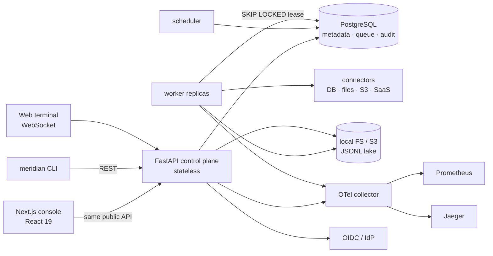
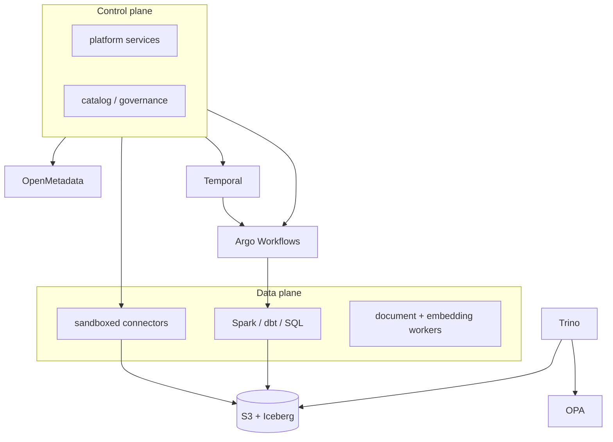

# Meridian — Enterprise Data Platform

**Design baseline + runnable reference product.** Meridian is a governed, self-service data platform for
relational, semi-structured and unstructured data. It lands data from any approved source, orchestrates
versioned DAGs, exposes a metadata catalog and enforces access at the data boundary — then makes the same
governed assets available to BI tools and GenAI workflows.

> **Status:** architecture v0.1 + reference implementation v0.1 · **Codename:** Meridian
> The design package describes the production target (Temporal, Argo, Iceberg, Trino, OpenMetadata, OPA).
> The runnable product in this repository is a deliberately smaller vertical slice: Postgres metadata,
> a leased task queue, DuckDB transforms and a local/S3 lake. It is not a SOC 2 certification.

---

## What runs today

| Capability | Reference implementation |
|---|---|
| Enterprise web console | Next.js 15 + React 19; enterprise shell, 16 product routes |
| Metadata persistence | PostgreSQL (SQLite for local tests) with datasets, schema versions, lineage, runs, tasks, audit |
| Connector architecture | Python SDK + discovery of `meridian.connectors` entry points; 8 first-party connector families |
| Relational / semi-structured / unstructured | PostgreSQL, MongoDB, CSV, JSON, JSONL, XML, XLSX, PDF, DOCX, HTML, text |
| Cloud / file / SaaS sources | Local files, HTTP REST, S3, SFTP, Box, OneDrive/SharePoint, Google Drive, user uploads |
| Distributed scheduling | Postgres `FOR UPDATE SKIP LOCKED` queue; API/worker/scheduler are independent stateless containers |
| DAG orchestration | Dependencies, parallel branches, retries/backoff, quality gates, approvals, notifications |
| Remote debugging | Breakpoints, pause/resume, step, live JSONL logs, event stream, retry |
| Third-party ETL integration | Airflow, dbt Cloud, Fivetran, Airbyte and generic webhook tasks |
| Security & governance | OIDC/JWT/API keys, six roles, tenant scoping, expiring access grants, PII detection, hash-chained audit |
| SOC 2 support | Control mapping, evidence, audit verification, retention, change/version history |
| OpenTelemetry | OTLP traces + metrics, Prometheus endpoint, trace/request IDs in every log |
| JSONL logging | stdout and rotating file logs; per-run append-only JSONL with shared `request_id` |
| Docker / Kubernetes / EKS | Compose stack, Kustomize manifests, HPA/PDB/NetworkPolicy, EKS guide and IRSA policy |
| CLI + web terminal | `meridian` Python CLI; restricted WebSocket application shell with audit |

### The design in ten lines

1. **Control plane + data plane.** Stateless services own definitions, metadata and policy; workers move bytes.
2. **Lakehouse target:** S3 + Apache Iceberg, Lakekeeper REST catalog, Trino for SQL and federation.
3. **Ingestion:** first-party connector SDK, sandboxed connector pods, outbound-only remote agent for on-prem.
4. **Orchestration:** Temporal for durable state, Argo Workflows for batch DAGs; exactly one scheduler.
5. **Autoscaling:** KEDA + Kueue + Karpenter + Spark dynamic allocation.
6. **Metadata:** platform-owned technical/operational metadata; OpenMetadata for glossary and lineage UI.
7. **Governance:** OPA RBAC/ABAC with obligations enforced at every data access point.
8. **Configuration:** immutable revisions, GitOps, promotion across dev → staging → prod.
9. **Experience:** one API behind the console, CLI, SDK and MCP server.
10. **AI:** ACL-aware RAG, shared semantic layer, citations or refusal.

The full production design is in [`docs/`](docs/) and [`adr/`](adr/).

---

## Quickstart — Docker Compose

Prerequisites: Docker Desktop / Docker Engine + Compose v2, ~8 GB RAM free.

```bash
cd deploy/compose
cp .env.example .env          # change MERIDIAN_JWT_SECRET
docker compose -f app.yaml up --build -d
docker compose -f app.yaml ps
```

| Endpoint | URL | Credentials |
|---|---|---|
| Web console | http://localhost:3000 | `admin@meridian.local` / `Meridian123!` |
| API + OpenAPI | http://localhost:8000/docs | Bearer JWT or API key |
| API health | http://localhost:8000/health/ready | — |
| Prometheus (profile `obs`) | http://localhost:9090 | — |
| Jaeger (profile `obs`) | http://localhost:16686 | — |

Demo personas (all use `Meridian123!`):

| Email | Role |
|---|---|
| `admin@meridian.local` | Platform administrator |
| `steward@meridian.local` | Data steward |
| `engineer@meridian.local` | Data engineer |
| `analyst@meridian.local` | Business analyst |
| `auditor@meridian.local` | Auditor |

Start observability too:

```bash
docker compose -f app.yaml --profile obs up --build -d
# set MERIDIAN_OTEL_ENABLED=true in .env first
```

Reset everything: `docker compose -f app.yaml down -v`.

The API container seeds a demo tenant on first start: sales CSV, restricted customer JSON, a DOCX policy
document, a medallion pipeline, two schedules and a pending access request.

---

## Quickstart — run from source

This is the fastest loop and the path used for local verification (SQLite + local object storage).

**Windows PowerShell**

```powershell
$env:UV_CACHE_DIR = "$PWD\.uv-cache"
uv sync --project services/platform-api --extra dev

# Terminal 1 — API
uv run --project services/platform-api uvicorn meridian.main:app --reload --port 8000

# Terminal 2 — worker
uv run --project services/platform-api python -m meridian.engine.worker

# Terminal 3 — scheduler
uv run --project services/platform-api python -m meridian.engine.scheduler

# Terminal 4 — web
cd apps/web
$env:npm_config_cache = "$PWD\..\..\.npm-cache"
npm install
npm run dev
```

**macOS / Linux**

```bash
export UV_CACHE_DIR="$PWD/.uv-cache"
uv sync --project services/platform-api --extra dev
uv run --project services/platform-api uvicorn meridian.main:app --reload --port 8000 &
uv run --project services/platform-api python -m meridian.engine.worker &
uv run --project services/platform-api python -m meridian.engine.scheduler &
cd apps/web && npm install && npm run dev
```

Open http://localhost:3000 and sign in with a demo persona.

### Verify the whole loop

```bash
# API, pipeline, worker, catalog, audit and RAG
uv run --project services/platform-api python scripts/smoke.py

# Full test suite
uv run --project services/platform-api pytest services/platform-api/tests -q -p no:cacheprovider

# CLI
MERIDIAN_CONFIG="$PWD/.data/cli.json" \
  uv run --project services/platform-api meridian login --url http://localhost:8000 \
  --email admin@meridian.local --password 'Meridian123!'
MERIDIAN_CONFIG="$PWD/.data/cli.json" \
  uv run --project services/platform-api meridian pipelines list
```

`scripts/smoke.py` starts the pipeline, drains four tasks through the worker, verifies `SUCCEEDED`, checks
that every run log carries the same request ID and asks the RAG assistant a policy question.

---

## Product tour

| Route | What to do |
|---|---|
| `/` | Overview: runs, success rate, schedules, lakehouse layers, inline RAG |
| `/sources` | Connect a source, test it, discover resources, upload a CSV/PDF/DOCX |
| `/ingestions` | Four-step wizard: source → resource → destination → schedule; run it |
| `/pipelines` | Create from a template, open the visual DAG editor |
| `/pipelines/{id}` | Drag tasks, configure SQL, set breakpoints, Save / Run / Debug |
| `/runs` | Filter runs; open a run graph, JSONL log, task output and debugger |
| `/schedules` | Cron schedules, arm/pause, run now |
| `/catalog` | Governed dataset cards, schema, profile, lineage, SQL workspace |
| `/governance` | Approve access, view classifications, verify the audit chain, SOC 2 evidence |
| `/security` | Users, roles, API keys |
| `/integrations` | Airflow, dbt Cloud, Fivetran, Airbyte, webhook |
| `/assistant` | ACL-aware RAG with citations |
| `/terminal` | Restricted WebSocket shell: `help`, `sources`, `runs`, `logs`, `run`, `ask` |
| `/settings` | Runtime configuration and architecture |

### Demo flow (10 minutes)

1. Sign in as **engineer**, open **Pipelines → Customer Revenue Daily**, click **Run**.
2. Open **Runs**, watch the graph; click **JSONL logs** and copy the request ID. It matches the run.
3. Edit the pipeline, set a breakpoint on **Clean & conform**, click **Debug**. The run pauses.
4. Open **Debugger → Resume to next breakpoint**; the run completes.
5. Open **Catalog → customer_pii_master** as **analyst**; preview is blocked. Submit an access request.
6. Sign in as **steward**, approve it in **Governance**. Re-open the dataset as analyst: preview works.
7. Ask **“What is the refund approval threshold?”** in **Ask Meridian**; inspect citations.
8. Open **Terminal**, run `runs`, `logs <run_id>`, `ask What is the refund policy?`.
9. In **Integrations**, add an Airflow endpoint and use `etl.trigger` in a DAG.

---

## Architecture

### Reference runtime (this repository)



### Production target



A service-by-service design, ADRs, domain model and OpenAPI contract are in [`docs/`](docs/), [`adr/`](adr/)
and [`specs/`](specs/). The implementation blueprint is [`docs/09-reference-product.md`](docs/09-reference-product.md).

---

## Repository layout

```text
enterprise-data-platform/
├── services/platform-api/          FastAPI app, scheduler, worker, connectors, CLI, tests
│   ├── src/meridian/
│   │   ├── api/                   REST, SSE, WebSocket routes
│   │   ├── engine/                DAG materialisation, task handlers, scheduler, worker
│   │   ├── services/              ingestion, datasets, transforms, RAG assistant
│   │   └── connectors/            file, REST, Postgres, S3, SFTP, MongoDB, cloud drives
│   └── tests/                     integration tests (SQLite + TestClient + real worker)
├── packages/connector-sdk/         dependency-free connector contract + entry-point registry
├── apps/web/                       Next.js 15 console
├── deploy/
│   ├── compose/app.yaml            runnable local stack
│   ├── k8s/                        Kustomize, HPA, PDB, NetworkPolicy
│   ├── eks/                        EKS cluster config, IRSA policy, guide
│   └── docker-compose.yaml         broader design stack (Temporal, Trino, Iceberg, Keycloak)
├── docs/                           architecture + reference product + SOC 2 mapping
├── scripts/smoke.py                end-to-end verification
├── specs/                          domain model, events, API contract, job spec
├── policies/                       OPA Rego + tests
└── adr/                            architecture decision records
```

### Deliberate implementation choices

- **Modular service chassis, independent roles.** One Python package runs API, scheduler and worker
  containers. This avoids duplicating auth, audit and models while preserving independent horizontal scaling.
  The module boundaries mirror the ten-service target; split them when ownership or scaling demands it.
- **No Redis.** The task queue is the metadata database. It removes a stateful dependency and makes
  `SKIP LOCKED` the single source of truth; at high throughput, move queue reads to a dedicated table partition.
- **DuckDB SQL transforms.** Fast, embeddable, MIT-licensed. Swap the `sql.transform` handler for Argo/Spark
  without changing the pipeline contract.
- **Local/S3 JSONL lake.** Portable, inspectable and simple; production target is Iceberg v2.
- **Extractive RAG by default.** Works offline, has citations, and refuses when context is insufficient.
  Configure an OpenAI-compatible gateway for synthesis.

---

## Security, privacy and compliance

- **Request ID everywhere:** inbound `X-Request-ID` is validated and echoed; the run inherits it; every task,
  connector call, audit event and JSONL log line carries it. Worker logs also include `run_id` and `task_id`.
- **Tenant isolation:** every query is filtered by the principal's `tenant_id`; dataset row access is checked
  server-side, not just hidden in the UI.
- **Secrets:** the metadata store only holds references (`env:`, `aws-sm:`, `file:`); values are resolved at
  execution time and never returned by the API.
- **Audit:** every mutation and restricted data read is appended to a SHA-256 hash chain; `/governance/audit/verify`
  recomputes it.
- **RBAC:** six roles; API keys inherit the issuing user's role, expire, and are stored as SHA-256 hashes.
- **PII:** column-name and value-pattern detection sets classifications; restricted datasets require expiring grants.
- **SOC 2:** control mapping and evidence are exposed in the console; see
  [`docs/10-soc2-control-mapping.md`](docs/10-soc2-control-mapping.md). This is readiness evidence, not a certificate.

Operational defaults to change before production: `MERIDIAN_JWT_SECRET`, demo seeding, local auth, TLS,
database credentials, S3 bucket policy, and the permissive CORS list.

---

## Testing

```bash
uv run --project services/platform-api pytest services/platform-api/tests -q -p no:cacheprovider
(cd apps/web && npm run lint)
(cd apps/web && npm run build)
docker compose -f deploy/compose/app.yaml config --quiet
kubectl kustomize deploy/k8s > /dev/null
```

The integration suite covers login/RBAC, DAG cycle rejection, the seeded pipeline end-to-end, breakpoint
pause/resume, restricted-data grants, audit-chain verification and RAG citations.

---

## Open-source licensing

The default stack is Apache-2.0, MIT or BSD-3-Clause. The optional SFTP extra uses Paramiko (LGPL-2.1) and is
not required for the core product; no AGPL components are included in the reference deployment. See
[`THIRD_PARTY.md`](THIRD_PARTY.md) for the inventory and the design alternatives (SeaweedFS instead of MinIO,
Prometheus/Jaeger instead of Grafana/Loki).

---

## Productionization backlog

The reference product is intentionally narrow. The highest-value next steps are:

1. Replace the container "worker" with sandboxed connector pods and Argo/Spark execution for large jobs.
2. Move the lake to Iceberg + Lakekeeper and add Trino for federation and policy enforcement.
3. Adopt OPA as the decision point (the RBAC matrix and policy inputs are already isolated).
4. Replace in-database JSONL chunks with OpenSearch k-NN embeddings for scale.
5. Add Alembic migrations, row-level security, SCIM provisioning and tenant-level KMS keys.
6. Add Temporal for long-running/human workflows and external-event triggers.
7. Ship JSONL logs to Loki/OpenSearch; remove the shared RWX logs volume dependency.
8. Add Terraform for VPC/EKS/RDS/S3/EFS and Argo CD for GitOps promotion.

See [`docs/09-reference-product.md`](docs/09-reference-product.md#913-known-gaps) for the detailed gap analysis.
