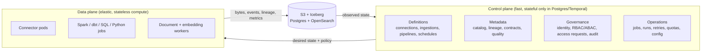
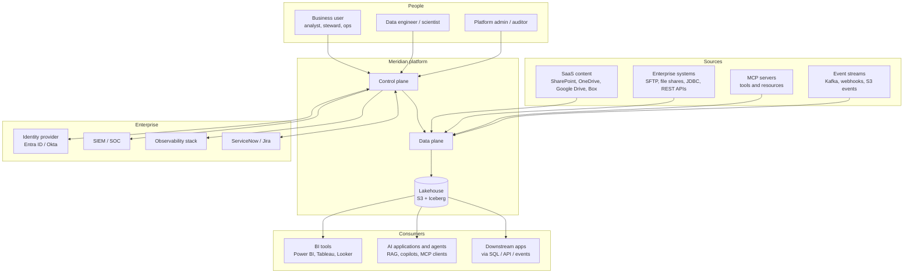
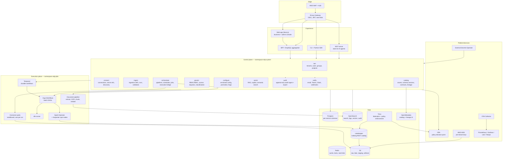
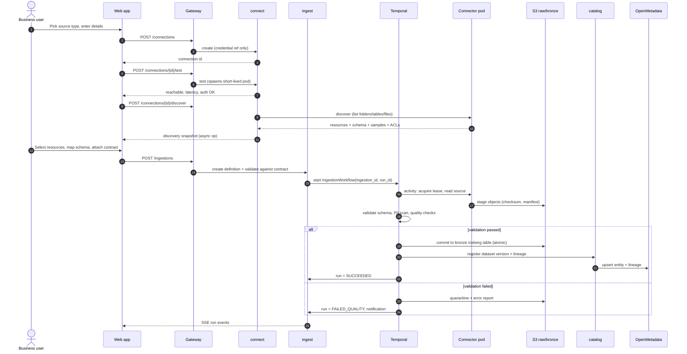
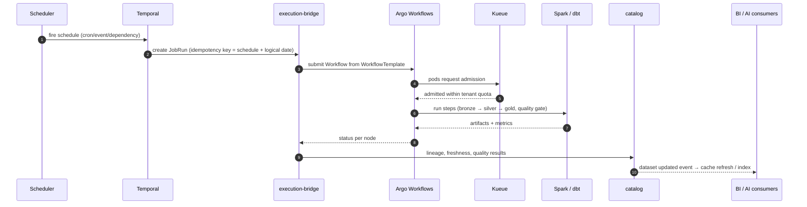
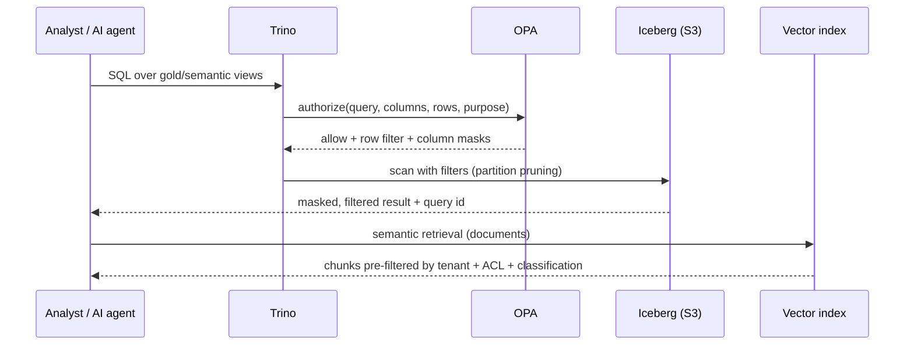
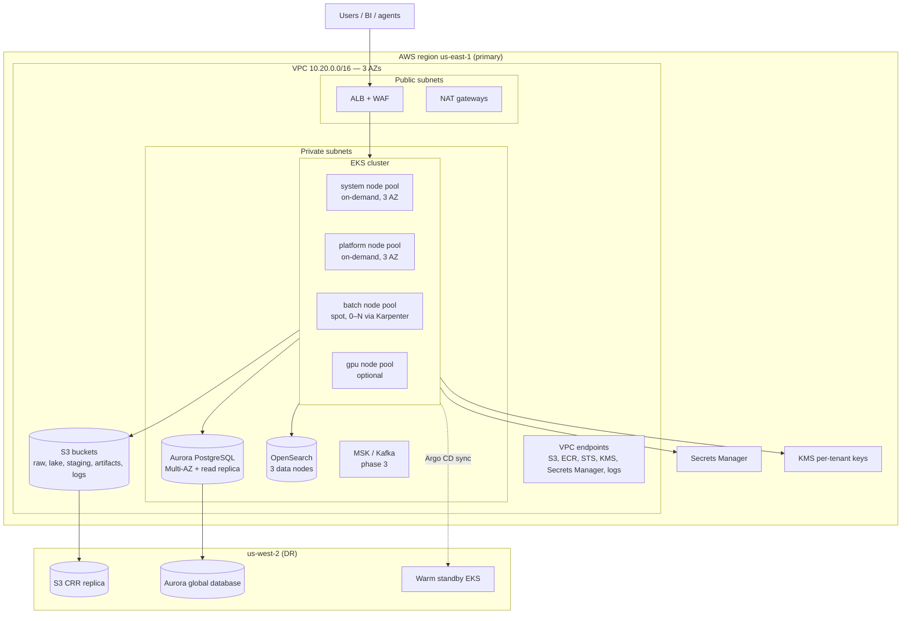

# 1. Architecture Overview

> **Document status:** design baseline v0.1 · **Audience:** architecture review board, platform engineering, data engineering, security
> **Scope:** the whole platform, end to end. Detailed designs live in docs 02–08.

---

## 1.1 What we are building

A single governed platform through which business users can connect to any approved data source, land the data
in a lakehouse, transform it, and expose it to BI tools and AI applications — without tickets, scripts, or
credentials spread across laptops.

The platform is a **control plane + data plane** system:

- The **control plane** is a set of stateless microservices that own definitions, permissions, metadata,
  scheduling and lifecycle. It never touches payload bytes.
- The **data plane** moves and processes bytes: sandboxed connector pods, Spark/dbt/SQL jobs on Kubernetes, the
  S3/Iceberg lakehouse, Trino for query, and the document/embedding pipeline for unstructured content.

This split is the most important decision in the design: it keeps the API fast and available, makes the data
plane horizontally scalable and disposable, and gives security a single choke point for authorization decisions.

**Working name:** *Meridian* (placeholder — replace with the company brand). Service names, namespaces and
resource prefixes in this package use `edp` / `meridian`.

---

## 1.2 Goals and non-goals

### Goals

| # | Goal | Measure of success |
|---|------|--------------------|
| G1 | Any authorized user can onboard a source and ingest data without writing code | ≥ 80% of new sources onboarded self-service |
| G2 | One copy of governed data serves both BI and AI | ≥ 70% of new datasets consumed by ≥ 2 workloads |
| G3 | Every byte is attributable and reproducible | 100% of datasets have owner, contract, lineage, last-run |
| G4 | Governance is enforced at the data, not just the door | 0 critical findings in access-path audit |
| G5 | Elastic, cost-aware compute | ≥ 60% of batch CPU on spot; p95 queue wait < 2 min |
| G6 | Operable by a small team | 1 platform SRE per ~150 workloads; MTTR < 30 min |

### Non-goals (deliberately out of scope)

- A general-purpose iPaaS for application integration (we are batch/file/event oriented, not a message broker for
  business transactions).
- A BI authoring tool — we serve Power BI / Tableau / Looker / Superset, we do not replace them.
- A model-training platform — we feed ML platforms (SageMaker, Databricks ML, MLflow) but do not run distributed
  training.
- An OLTP database, or a system of record for business transactions.
- A public data marketplace for external monetization (phase 4 option, not a design driver).

---

## 1.3 Sizing baseline (replace with your numbers)

All capacity, quota and cost decisions in this package are calibrated to this baseline. Treat it as a
parameter, not a fact.

| Dimension | Baseline | Design headroom |
|---|---|---|
| Named users / concurrent | 1,500 / 300 | 5,000 / 1,000 |
| Source systems / configured connections | 40 / 400 | 150 / 2,000 |
| Structured ingest volume | 5 TB/day | 25 TB/day |
| Lake size, year 1 | 2 PB compressed | 10 PB |
| Unstructured documents | 100k/day, avg 800 KB | 500k/day |
| Job runs | 15,000/day | 80,000/day |
| Peak concurrent task pods | 400 | 2,000 |
| Tenants (business units) | 6 | 50 |
| Regions | 1 primary + DR | 2 active |

---

## 1.4 Functional requirements → components

| ID | Requirement | Primary components |
|----|-------------|--------------------|
| FR-01 | Connect to SFTP, HTTPS REST, MCP, file system, SharePoint, OneDrive, Google Drive, Box, S3, JDBC, Kafka, webhooks | `connect` service, `connector-runtime`, `remote-agent` |
| FR-02 | Business-user ingestion wizard: discover → preview → map → validate → schedule | `ingest` service, web app, `catalog` |
| FR-03 | Batch, incremental, CDC and event-driven ingestion | `ingest`, Temporal workflows, Kafka Connect (phase 3) |
| FR-04 | Unstructured processing: extract, OCR, chunk, embed, classify, ACL | `assist`/document pipeline, Textract/Tika, OpenSearch |
| FR-05 | Aggregation into a governed lakehouse with federation | S3 + Iceberg + Lakekeeper, Trino, `catalog` |
| FR-06 | Batch processing: Spark, dbt, SQL, Python | Argo Workflows, Spark Operator, dbt, Trino |
| FR-07 | Scheduling: cron, calendar, event, dependency, backfill, SLA | `orchestrate` (scheduler), Temporal schedules |
| FR-08 | Durable asynchronous execution incl. human approval | Temporal, `orchestrate` |
| FR-09 | Metadata: catalog, schema, lineage, glossary, contracts, quality | `catalog`, OpenMetadata, OpenLineage |
| FR-10 | Security: SSO, RBAC/ABAC, row/column controls, masking, audit, privacy | `govern`, OPA, Trino policies, KMS |
| FR-11 | Configuration management: versioned, reviewable, promotable | `configure`, Git, Argo CD, Terraform |
| FR-12 | Job/task management: lifecycle, logs, retries, quotas, cancellation | `orchestrate`, Kueue, Loki |
| FR-13 | Machine access: REST API, SDK, MCP server for AI agents | Envoy Gateway, `platform-api`, MCP server |
| FR-14 | BI and AI enablement: semantic layer, RAG, copilot | `assist`, dbt metrics, Trino, model gateway |
| FR-15 | Kubernetes deployment (EKS) and Docker Compose locally, autoscaling | Karpenter, KEDA, Kueue, HPA, Helm |

### Non-functional requirements

| ID | Requirement | Target |
|----|-------------|--------|
| NFR-01 | Control-plane availability | 99.9% monthly (43 min) |
| NFR-02 | API latency | p95 < 300 ms, p99 < 800 ms at 300 RPS |
| NFR-03 | Scheduling latency | trigger → pod scheduled p95 < 10 s |
| NFR-04 | Durability | S3 11 nines; Postgres PITR 35 days; RPO 5 min |
| NFR-05 | Isolation | No cross-tenant read path; per-tenant KMS keys |
| NFR-06 | Scale | Linear to 5× baseline without re-architecture |
| NFR-07 | Security | SOC 2 Type II + ISO 27001 ready; GDPR; HIPAA-capable |
| NFR-08 | Observability | 100% of runs traceable end-to-end by `run_id` |
| NFR-09 | Portability | No proprietary compute lock-in; K8s + S3 API + Iceberg |
| NFR-10 | Cost | Showback per tenant/project; ≥ 40% spot for batch |
| NFR-11 | Recoverability | Tier-0 RTO 1 h; gold data RTO 4 h; bronze replayable from raw |

---

## 1.5 Design principles

1. **Compose proven engines; own the control plane and the glue.** We are not building a query engine, a
   scheduler daemon, or an orchestration state machine. We build the tenancy, governance, UX and integration
   layer that those engines lack.
2. **One deployable per bounded context, not per noun.** Start with ten services; split only when a scaling,
   ownership or failure-isolation argument exists. Nano-services are a tax, not a virtue.
3. **Everything is a versioned, declarative resource.** Connections, ingestions, pipelines, policies and quotas
   have a spec, a revision, an owner and an audit trail — and can round-trip to Git.
4. **Metadata is emitted, not documented.** Connectors and jobs emit OpenLineage and statistical metadata by
   default; a dataset with no lineage fails CI.
5. **Policy at the point of access.** The UI hides what you cannot see, and Trino/S3/OpenSearch enforce it
   anyway. Never rely on UI filtering for security.
6. **Tenant isolation by default.** `tenant_id` on every row, namespace per tenant, quota per tenant, KMS key
   per tenant. Hard isolation (dedicated cluster) is a tier, not a rewrite.
7. **Idempotent, resumable, replayable.** Every run has an idempotency key, checkpoints to object storage, and
   can be re-run without duplicating data.
8. **Asynchronous by default.** Any operation that can exceed 1 s returns `202` + an addressable operation
   resource. No long-held HTTP connections, no chatty synchronous chains.
9. **Boring, portable infrastructure.** Kubernetes, S3 API, Postgres, Iceberg, OpenTelemetry. Every choice must
   survive a cloud migration or an on-prem repatriation.
10. **Secure by construction.** No long-lived credentials in the platform, no privileged pods, no shared
    service accounts across tenants, signed artifacts only.

---

## 1.6 System context

---

## 1.7 Container view

---

## 1.8 Service catalog

Ten deployable control-plane services, plus execution components. Each service owns its schema in Postgres and
exposes a versioned API; no service reads another's tables.

| Service | Bounded context | Owns (data) | Key APIs | Scales on | Phase |
|---|---|---|---|---|---|
| `iam` | Identity & tenancy | tenants, users, groups, projects, role bindings | `/tenants`, `/projects`, `/me`, SCIM callbacks | RPS (HPA) | 0 |
| `connect` | Connectivity | connections, credential refs, discovery snapshots, source ACLs | `/connections`, `/connections/{id}/test`, `/discover` | RPS | 0 |
| `ingest` | Ingestion | ingestion definitions, runs, validations, watermarks | `/ingestions`, `/ingestions/{id}/runs` | RPS + queue | 0 |
| `orchestrate` | Orchestration & jobs | pipelines, pipeline versions, schedules, job runs, attempts | `/pipelines`, `/schedules`, `/runs`, `/backfills` | RPS + queue | 0 |
| `catalog` | Metadata | assets, datasets, schema versions, contracts, lineage edges, quality results | `/assets`, `/datasets`, `/lineage`, `/search` | RPS | 0 |
| `govern` | Policy & access | policies, classifications, access requests, grants | `/policies`, `/access-requests`, `/decide` | RPS | 1 |
| `configure` | Configuration | config revisions, promotions, feature flags, drift reports | `/config/{kind}/{name}` | RPS | 0 |
| `audit` | Audit | audit events (append-only), exports | `/audit/events` (write), `/audit/search` | Ingest rate | 0 |
| `notify` | Notifications | subscriptions, deliveries, templates | `/notifications` | Queue | 1 |
| `assist` | AI enablement | RAG indexes, conversations, prompts, evals | `/assist/ask`, `/assist/search` | Token/RPS | 2 |

Non-service runtime components:

| Component | Role | Isolation |
|---|---|---|
| `connector-runtime` | Executes one connector task per pod, invoked by Temporal activity | Pod security restricted, egress allowlist, read-only root FS |
| `remote-agent` | Outbound-only agent in customer/on-prem network for SFTP/file shares/JDBC | mTLS to gateway, no inbound ports |
| `doc-processor` | Extract → OCR → chunk → embed → index | Batch pod, no network except S3/OpenSearch/model endpoint |
| `scheduler` | Part of `orchestrate`, leader-elected; materializes schedules into Temporal | 2 replicas, leader election |
| `execution-bridge` | Translates a `JobRun` into an Argo `Workflow` / Temporal workflow and reflects status back | Part of `orchestrate` |
| `lineage-collector` | Consumes OpenLineage events, normalizes, writes Postgres + OpenMetadata | 2 replicas |
| `usage-meter` | Aggregates compute/storage per tenant for showback | 1 replica |

**Why only ten services?** Each maps to a team-sized ownership boundary and a distinct scaling profile. The
temptation to split `catalog` into "assets / lineage / search / contracts" produces four services that deploy
together and query the same database — pure overhead at this stage. The boundaries are enforced in code
(module layout + API contracts) so they *can* be split later without a rewrite.

---

## 1.9 Technology stack and rationale

| Layer | Choice | Why | Alternatives considered |
|---|---|---|---|
| Compute substrate | **Amazon EKS**, Bottlerocket nodes, Karpenter | Managed control plane, spot flexibility, no cluster ops | ECS (weaker batch ecosystem), self-managed K8s |
| Local dev | **Docker Compose** (+ optional k3d) | One command for the core stack; k3d for K8s-specific work | Kind, DevSpace |
| Control-plane language | **Python 3.12 + FastAPI** | Fastest path for data-domain services; shared libs with connectors | Java/Spring (better typing, slower iteration), Go |
| Connector SDK | **Python** | Richest client ecosystem (Graph, Google, Box, SFTP, MCP) | Java, Node |
| Operational DB | **PostgreSQL 16** (Aurora or RDS Multi-AZ) | Transactions, RLS, JSONB, proven | CockroachDB (cost), DynamoDB (query needs) |
| Cache / locks / rate limit | **Redis 7** | Cheap, well-understood | Memcached |
| Object storage | **Amazon S3** | Durability, lifecycle, Object Lock, replication | GCS/Azure Blob (portability via S3 API) |
| Table format | **Apache Iceberg 1.6+** | Open, ACID, time travel, engine-neutral, row-level deletes | Delta Lake (Databricks gravity), Hudi (heavier) |
| Iceberg catalog | **Lakekeeper** (REST) | Multi-tenant RBAC, engine-neutral, no Glue lock-in | AWS Glue (simplest, thin RBAC), Nessie (git-like branching) |
| Query / federation | **Trino** | Federates S3, Postgres, SaaS; policy plugin; mature | Athena (serverless but limited DDL/policy), Starburst |
| Batch compute | **Apache Spark 3.5 on K8s** + **dbt** + **Polars** | Spark for scale, dbt for SQL transforms, Polars for small fast jobs | Flink (streaming), Ray (ML), Databricks (lock-in) |
| Orchestration (durable) | **Temporal** | Durable state, timers, retries, human-in-the-loop, versioning | Airflow (scheduler-centric), Step Functions (lock-in) |
| Batch DAG execution | **Argo Workflows** | K8s-native, artifact passing, per-step pods, UI | Airflow, Tekton, Kubeflow Pipelines |
| Queue / admission | **Kueue** | Multi-tenant quotas, fair sharing, preemption for batch | Volcano, raw namespaces + quotas |
| Autoscaling | **KEDA + HPA + Karpenter** | Queue-driven scale-to-zero; node-level spot optimization | Cluster Autoscaler |
| Metadata backbone | **OpenMetadata** | Glossary, ownership, lineage UI, classification, tests, RBAC | DataHub (heavier ops), custom build |
| Search / vectors / logs | **OpenSearch** | One cluster for catalog search, k-NN, logs, audit | Elasticsearch (license), pgvector (scale), Pinecone |
| Policy | **OPA** (Rego), bundles from Git | Policy-as-code, testable, decoupled from services | Cedar/AVP, embedded checks |
| Identity | **Entra ID / Okta** via OIDC + SCIM | Enterprise SSO, group sync, conditional access | Keycloak (dev only) |
| Secrets | **AWS Secrets Manager** + ESO | Rotation, audit, no secrets in Git/DB | Vault (viable, more ops) |
| GitOps | **Argo CD** + **Helm** + **Terraform** | Declarative, drift detection, promotion | Flux, Pulumi |
| Observability | **OpenTelemetry** → Prometheus, Grafana, Loki, Tempo | Vendor-neutral, trace continuity across Temporal/Argo | Datadog (fine, costly) |
| Frontend | **Next.js 15 + TypeScript + Tailwind + shadcn/ui** | Fast, accessible, server components for data-heavy views | Angular, Retool (not for a product) |

---

## 1.10 Core flows

### Flow A — self-service ingestion (structured or file)

### Flow B — scheduled batch pipeline

### Flow C — governed answer for BI or AI

---

## 1.11 Deployment topology (production)

Namespaces: `edp-system` (control plane), `edp-jobs` (Argo, Temporal workers), `edp-data` (Trino, Lakekeeper),
`edp-observability`, `edp-security` (OPA, Kyverno), `tenant-<slug>` (tenant-scoped jobs and quotas).

---

## 1.12 What we deliberately do not build

| Not building | Use instead | Consequence |
|---|---|---|
| Query engine | Trino / Spark SQL | Must keep Iceberg + catalog standards-compliant |
| Workflow engine | Temporal | Must accept Temporal's programming model |
| Scheduler daemon | Temporal schedules + our scheduler service | Cron edge cases (DST, calendars) are our code |
| Catalog/lineage UI v1 | OpenMetadata | Two-UI risk; mitigated by embedding and deep links |
| Connector for every SaaS | 12 first-party families + Airbyte-compatible adapters | Long-tail connectors via adapter, not core |
| Secret store | AWS Secrets Manager | AWS coupling at this layer only, abstracted by `SecretPort` |
| BI authoring | Power BI / Tableau / Looker / Superset | We own the semantic layer, not the canvas |
| LLM hosting | Bedrock / Azure OpenAI / on-prem vLLM via model gateway | Model choice is configuration, not code |

---

## 1.13 Key decisions

| ADR | Decision | One-line rationale |
|---|---|---|
| [0001](../adr/0001-compose-engines.md) | Compose engines, own the control plane | Time-to-value and focus |
| [0002](../adr/0002-iceberg-s3-lakehouse.md) | Iceberg on S3, Lakekeeper catalog | Open, multi-engine, multi-tenant |
| [0003](../adr/0003-temporal-and-argo.md) | Temporal for durable state, Argo for batch DAGs | Each does what it is best at; one owner per concern |
| [0004](../adr/0004-openmetadata.md) | OpenMetadata as metadata backbone | Mature governance without a multi-year build |
| [0005](../adr/0005-opa-abac.md) | OPA + ABAC, enforced at data access | Auditable, testable policy |
| [0006](../adr/0006-kueue-karpenter-keda.md) | Kueue + Karpenter + KEDA for autoscaling | Quotas, spot, queue-driven elasticity |
| [0007](../adr/0007-connector-sdk.md) | First-party connector SDK + runtime | Control over governance, ACLs, sandboxing |
