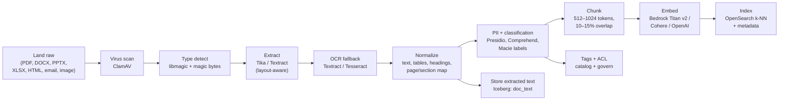

# 2. Data Plane: Lakehouse, Ingestion and Unstructured Content

> Covers FR-01, FR-03, FR-04, FR-05. Implements the storage and movement half of Flow A.

---

## 2.1 Lakehouse layout

One S3 bucket set per environment per region; tenant separation by prefix **and** bucket policy **and** KMS key.
Buckets are versioned, blocked from public access, encrypted with SSE-KMS, and logged via CloudTrail data events.

| Zone | Path | Format | Mutability | Retention default | Written by |
|---|---|---|---|---|---|
| `raw` | `s3://edp-raw-{env}/{tenant}/{source}/{object}/{ingest_date}/{run_id}/` | original bytes + `_manifest.json` | immutable (Object Lock optional) | 7 years or policy | connector pods |
| `staging` | `s3://edp-staging-{env}/{tenant}/{run_id}/` | any | ephemeral, 7-day lifecycle | 7 days | connector pods, uploads |
| `bronze` | `s3://edp-lake-{env}/warehouse/{tenant}/{domain}/bronze/{table}/` | Iceberg | append / insert-only | 7 years | ingest workflows |
| `silver` | `.../silver/{table}/` | Iceberg | merge / upsert (CDC apply) | 7 years | pipelines |
| `gold` | `.../gold/{table}/` | Iceberg | replace / merge | indefinite | pipelines, dbt |
| `sandbox` | `.../sandbox/{user}/{project}/` | Iceberg or Parquet | free | 30 days | analysts/scientists |
| `quarantine` | `s3://edp-quarantine-{env}/{tenant}/{run_id}/` | original + `_errors.jsonl` | 30 days | review then purge | validation steps |
| `artifacts` | `s3://edp-artifacts-{env}/{tenant}/{run_id}/` | logs, plans, dbt artifacts, samples | 90 days | 90 days | Argo / Temporal |
| `models` | `s3://edp-models-{env}/{tenant}/{model}/{version}/` | model artifacts | versioned | policy | ML consumers |
| `audit` | `s3://edp-audit-{env}/` | JSONL, hash-chained | immutable (compliance lock) | 7 years | `audit` service |

### Naming conventions

- Iceberg namespace: `{tenant}.{domain}` (e.g., `acme.finance`).
- Table: `{layer}_{entity}[_{grain}]` lowercase snake case — `bronze_sap_invoices`, `silver_invoice_lines`, `gold_ar_aging_daily`.
- Asset URN: `urn:edp:{tenant}:{domain}:{layer}.{table}` — stable across renames (rename changes `name`, not URN).
- Run ID: ULID, time-sortable, appears in every log line, S3 path, span attribute and audit event.

### Iceberg table standards

| Concern | Standard |
|---|---|
| Partitioning | Date-based (`days(ingest_ts)` for bronze, business date for silver/gold); avoid high-cardinality keys |
| File size | Target 128–256 MB parquet; compaction job per table when avg file < 64 MB or > 1,000 files/partition |
| Snapshots | Bronze: expire 30 days (raw is the backup). Silver/gold: 90 days + tag on release |
| Schema evolution | Additive only in bronze; silver/gold may rename/drop via view-first migration |
| Row-level ops | Iceberg v2 deletes; **do not** enable on bronze (append-only) |
| Statistics | Column-level NDV, null %, min/max collected on write; used by `catalog` for profiling |
| Sort | `ZORDER`-style compaction on frequent filter columns (Trino `OPTIMIZE`) |
| Security | Lakekeeper namespace-level RBAC; S3 prefix policy as second layer |

---

## 2.2 Ingestion taxonomies

Every source is modeled by **four independent choices**, which keeps the connector interface small:

1. **Transport** — how bytes arrive: pull (API/SFTP), push (webhook/event), agent relay (on-prem), stream.
2. **Discovery** — how we learn what exists: list/stat, schema introspection, OpenAPI, MCP `list_resources`, delta API.
3. **Change detection** — full snapshot, high-watermark, cursor/pagination, content hash, log-based CDC, delta token.
4. **Shape** — tabular records, semi-structured documents (JSON/XML/Parquet), unstructured binaries (PDF/DOCX/images).

The ingestion definition stores these as explicit, reviewable fields rather than inferring them at runtime.

### Ingestion patterns

| Pattern | When | Mechanism |
|---|---|---|
| Full snapshot | Small dimensions, no reliable watermark | Read all, write new Iceberg snapshot, swap via view |
| Incremental append | Immutable events, logs | `updated_at`/sequence watermark stored on the ingestion definition |
| Incremental merge | Mutable entities | Watermark + primary key + Iceberg `MERGE INTO` |
| Delta token | SaaS APIs (Graph, Drive, Box) | Provider delta/cursor persisted; replay on token expiry by full resync |
| Log-based CDC | OLTP databases | Debezium → Kafka → Iceberg sink (phase 3); until then watermark + nightly reconcile |
| File-drop | SFTP/share/Box folder | Manifest + mtime/size/hash; tombstones on disappearance (configurable) |
| Event push | Webhooks, S3 events, Kafka | Gateway verifies HMAC → `ingest` receives envelope → Temporal workflow |
| Reference/lookup | Tiny, frequently reused | Cached in Redis + materialized to gold dimension |

**Idempotency contract:** every ingestion run computes `run_key = sha256(ingestion_id + logical_date + params)`.
Re-running the same key with the same watermark is a no-op; re-running with `force=true` produces a new Iceberg
snapshot and supersedes the previous `run_key` mapping. Bronze writes are keyed by `_edp_run_id` and
`_edp_ingest_ts` so duplicates are detectable with a single query.

---

## 2.3 Connector framework

### Design goals

- A new connector in **days, not months**: manifest + adapter class + fixtures.
- **Uniform governance**: every connector reports source ACLs, PII candidates and lineage.
- **Sandboxed by default**: no network except the source and S3; no long-lived credentials.
- **Resumable**: checkpoint to S3 every 30 s or 100 MB; survive pod eviction (spot).

### Interfaces

```python
# packages/connector-sdk/edp_connector/contracts.py
class Connector(Protocol):
    def test(self, ctx: RunContext) -> Health: ...
    def discover(self, ctx: RunContext) -> Iterator[Resource]: ...        # folders, drives, tables, topics
    def describe(self, resource: Resource) -> Schema: ...
    def read(self, resource: Resource, cursor: Cursor, sink: Sink) -> Iterator[Batch]:
        """Stream bytes/records to sink; must call ctx.checkpoint() periodically."""
    def acl(self, resource: Resource) -> SourceACL: ...                    # users/groups with read access
    def classify(self, sample: Sample) -> list[ClassificationHint]: ...    # optional PII hints
```

`Sink` writes to staging (files) or to an Arrow stream (records). The runtime, not the connector, performs
checksums, manifest generation, quarantine on schema violation, and the bronze commit.

### Runtime contract

| Aspect | Requirement |
|---|---|
| Packaging | OCI image, `linux/amd64` + `arm64`, signed (cosign), SBOM attached |
| Entrypoint | `/edp/run --spec /etc/edp/run.json` |
| Config | JSON spec mounted read-only (no secrets; secrets mounted as files from ESO) |
| Identity | IRSA service account per connector class, scoped to tenant prefix |
| Network | Egress allowlist via NetworkPolicy + DNS policy; optional static egress IP for source allowlisting |
| Filesystem | Read-only root; writable `/tmp` (emptyDir, 10 GiB); no host mounts |
| Resources | Requests/limits mandatory (default 500m/1Gi, burst 2/4Gi) |
| Lifecycle | SIGTERM → finish current batch, checkpoint, exit ≤ 30 s |
| Logs | JSON lines to stdout: `run_id`, `tenant`, `resource`, `phase`, `bytes`, `records`, `error_code` |
| Traces | OTel spans per resource and per batch; propagated from Temporal |
| Checkpoint | `s3://.../checkpoints/{run_id}/{resource_id}.json` every 30 s / 100 MB |
| Limits | Max runtime 12 h (configurable), max object 50 GB (multipart), max records/batch 50k |

### Connector matrix

| Source | Auth | Discovery | Change detection | Deletes | Notes / constraints | Phase |
|---|---|---|---|---|---|---|
| **SFTP** | SSH key (preferred), password + pinned host key | `LIST`/`STAT` recursive | mtime + size + content hash | manifest tombstones; optional "missing after N runs" | No server-side checksums on all servers; on-prem via `remote-agent`; chroot + allowlisted roots | 1 |
| **HTTPS REST** | OAuth2 client credentials, API key, bearer, mTLS | OpenAPI 3 spec or manual resource list | cursor, `updated_at`, ETag, offset paging | soft-delete fields / tombstone endpoint | Per-connector rate limits (token bucket); retry `429` with `Retry-After`; response size caps | 1 |
| **MCP** | OAuth 2.1 (streamable HTTP) or stdio via agent | `tools/list`, `resources/list` | resource version/etag or timestamp field | none (source of truth) | Tool allowlist, output size caps, no arbitrary code execution; each tool call traced | 2 |
| **File system** | `remote-agent` mTLS + OS-level service account | scan or `inotify` watch | mtime + size + hash | tombstone after scan | Allowlisted roots, symlink escape prevention, ACL snapshot from OS | 1 |
| **SharePoint** | Microsoft Graph: app-only (sites.selected) or delegated | sites → drives → items/lists | Graph **delta** API per drive/list | delta `deleted` facet + recycle bin | Sensitivity labels surfaced as tags; throttling (429) is the norm — backoff required | 1 |
| **OneDrive** | Graph delegated or app-only | drives → items | delta API | delta `deleted` | Personal vs business drives; per-user consent for delegated | 1 |
| **Google Drive** | Service account + domain-wide delegation, or OAuth per user | drives → files, shared drives | `changes` API with page token | `trashed`/`removed` | Export Google Docs/Sheets/Slides to DOCX/XLSX/PDF; 10 MB export cap | 1 |
| **Box** | OAuth 2.0 (JWT app or user), CCG | folders → items, metadata templates | Enterprise Events stream / folder events; or mtime | `trashed` events | Box Governance/Shield labels as classification source | 1 |
| **Amazon S3** | IRSA | `ListObjectsV2` | versioning + event notifications | delete markers | Same-account and cross-account (bucket policy + `ExternalId`) | 0 |
| **JDBC** | DB user / IAM auth (Postgres, MySQL, SQL Server, Oracle) | `information_schema` | watermark column; CDC via Debezium later | requires CDC or periodic reconcile | Pushdown of projection/filter when safe; never `SELECT *` blindly | 2 |
| **Kafka** | SASL/SCRAM, mTLS, IAM | topic metadata | consumer offsets | tombstone records | Schema Registry (Avro/Protobuf/JSON Schema); exactly-once sink via Iceberg | 3 |
| **HTTP webhook (push)** | HMAC signature + shared secret | declared by sender | event envelope | explicit delete events | Gateway verifies, dedupes by `event_id`, enqueues | 2 |
| **Airbyte adapter** | inherited | inherited | inherited | inherited | Wraps an Airbyte source image as a low-code connector; bypasses our ACL reporting — flagged in catalog | 2 |

> **Why not just Airbyte?** It solves the long tail of SaaS sources, but it does not give us source-ACL
> propagation, tenant-scoped secret handling, MCP, on-prem agent relay, or the same audit/lineage semantics.
> We adopt its *connector images* as an optional adapter (phase 2), not its control plane.

### On-premises access (`remote-agent`)

For SFTP, SMB/NFS shares and databases inside a customer network, inbound connectivity is usually impossible.
The agent runs as a container or VM in the customer network and:

- Dials **out** over mTLS (443) to the platform's agent gateway; no inbound ports, no VPN.
- Registers with a tenant-scoped enrollment token; certificate rotated every 30 days.
- Receives signed task specs (connector image + config), executes in a local sandbox, streams to S3 via
  pre-signed multipart URLs.
- Enforces local path allowlists, max bandwidth, and a local audit log shipped to the platform.

---

## 2.4 Unstructured and semi-structured content

### Pipeline



### Decisions

| Question | Decision | Reason |
|---|---|---|
| Where does extracted text live? | Iceberg `{tenant}.{domain}.bronze_document_text` + chunks in `bronze_document_chunk` | Re-chunking and re-embedding without re-extraction; SQL-queryable provenance |
| Where do vectors live? | OpenSearch k-NN (HNSW), one index per tenant, `acl` and `classification` fields | Reuse existing cluster; pre-filtered retrieval; no separate vendor |
| Chunking | Structure-aware: split on headings/pages/tables first, then token windows; store `section_path` | Retrieval quality depends more on chunking than on model choice |
| Deduplication | SHA-256 of normalized text; near-dup via MinHash on 5-gram shingles | Avoid paying to embed the same policy PDF 40 times |
| PII in vectors | Detect + redact before embedding; store `pii_spans` so answers can be masked | Embeddings leak; do not embed raw SSNs |
| Re-embedding | Versioned embedding model + index alias (`docs_v3`); reindex job per model change | Model upgrades must not break retrieval |
| Access control | Source ACLs mapped to platform groups at ingest; **pre-filter** vectors by tenant + ACL at query | Post-filtering leaks existence and counts |
| Native files | SharePoint/Drive/Box keep ACLs; a permission-sync job runs daily + on webhook | Permission drift is the #1 RAG leak |

### Supported formats

`pdf`, `docx`, `pptx`, `xlsx`, `csv`, `tsv`, `json`, `jsonl`, `xml`, `html`, `md`, `txt`, `eml`, `msg`,
`png`, `jpg`, `tiff`, `mp3`/`mp4` (transcript, phase 3), `parquet`, `avro`, `orc`.

Semi-structured (JSON/XML/Parquet/Avro) is **flattened into typed columns with a preserved `_raw` column**;
schema-on-read is offered for exploration but promoted datasets must have an explicit contract.

---

## 2.5 Data quality and contracts

### Contract

```yaml
apiVersion: catalog.edp.example/v1
kind: DataContract
metadata: { name: acme.finance.silver_invoice_lines, tenant: acme }
spec:
  owner: finance-data@acme.example
  domain: finance
  sla: { freshness: 6h, availability: "99.5%", supportHours: "business" }
  schema:
    - { name: invoice_id, type: string, nullable: false, pii: false }
    - { name: vendor_name, type: string, nullable: true, pii: false }
    - { name: amount_usd, type: decimal(18,2), nullable: false }
    - { name: employee_ssn, type: string, nullable: true, pii: true, classification: RESTRICTED }
  keys: [invoice_id, line_no]
  quality:
    - { type: not_null, columns: [invoice_id], severity: error }
    - { type: unique, columns: [invoice_id, line_no], severity: error }
    - { type: accepted_values, column: currency, values: [USD, CAD, EUR], severity: warn }
    - { type: row_count_range, min: 1000, max: 5000000, severity: warn }
  evolution: additive_only
```

### Enforcement points

| Point | Check | On failure |
|---|---|---|
| Ingestion (pre-commit) | Schema compatibility, nullability, type parse, row count bounds | Quarantine + `FAILED_QUALITY`, no bronze commit |
| Bronze → silver | Contract validation + dbt tests | Pipeline halts before publishing to gold |
| Gold publish | Contract CI check + freshness + row-count drift | Publish blocked; consumers keep last good snapshot |
| Continuous | Freshness, volume anomaly, schema drift monitor | Alert + auto-open incident in `notify` |

Quality engines: **dbt tests** for transformed models, **Soda Core** (or Great Expectations) for ingestion and
continuous checks. Results are always written to `catalog.quality_result` and surfaced in OpenMetadata.

**Severity semantics:** `error` blocks; `warn` records and notifies; `info` records only. Every dataset has a
"last good version" pointer so consumers never read a partially validated snapshot.

---

## 2.6 Aggregation and federation

- **Physical aggregation** into the lakehouse is the default for anything consumed more than once.
- **Virtual federation** via Trino for low-volume operational reads, prototypes, and sources that cannot be
  copied (regulatory). Federated sources are marked `virtual` in the catalog and excluded from freshness SLAs.
- **Materialization decision rule:** if a federated query runs more than 3×/day or scans > 1 GB, promote it to
  a scheduled bronze/silver dataset.
- Cross-tenant aggregation is prohibited by default; a `consortium` tenant can be granted read-only access to
  specific gold views via explicit policy (for group-level reporting).

### Aggregation patterns

| Pattern | Problem it solves | Implementation | Lands in |
|---|---|---|---|
| Conformed union | The same entity arrives from six systems (invoices from SAP, Coupa, Box) | Normalize to a canonical schema, add `_source_system`, dedupe on the business key | `silver_invoice` |
| Entity resolution | A customer appears with different names and IDs across sources | Match rules (exact → fuzzy → probabilistic), survivorship rules, a `golden_id` mapping table | `silver_party`, `gold_party_master` |
| Snapshot / rollup | BI needs daily AR aging, not 40M invoice rows | Incremental aggregate keyed by `(date, segment)`, idempotent partition overwrite | `gold_ar_aging_daily` |
| Cross-source join | Revenue vs. support tickets vs. usage | Build conformed dimensions first (date, customer, product), then facts | `gold_*` |
| Late-arriving facts | Yesterday's file arrives today | Watermark replay of affected partitions; the aggregate is recomputed, not patched | silver + gold |
| Ingest dedupe | API pagination or retries repeat rows | `MERGE` on the natural key; `_edp_run_id` retained for audit | bronze → silver |

**Rule:** aggregation logic is code (dbt or Spark) in Git, reviewed and tested — never SQL pasted into a BI tool.
A metric that only exists in a dashboard is a metric nobody can govern.

---

## 2.7 Streaming (phase 3, designed for now)

- MSK + Kafka Connect (Debezium) for CDC; Flink for stateful transforms; Iceberg sink with exactly-once commit.
- The control plane already models `stream` ingestion definitions, consumer offsets and checkpoints, so the
  phase-3 change is a new executor, not a new domain model.
- Streaming tables land in bronze with `_kafka_partition`, `_kafka_offset`, `_kafka_ts`; compaction to silver is
  a scheduled batch job (micro-batch), not a second pipeline definition.

---

## 2.8 Capacity and cost notes

- Connector pods are the dominant pod count: size 1 vCPU / 2 GiB, run on spot, KEDA-scaled by queue depth.
- Target 30–50 MB/s per connector pod for large files; scale horizontally by splitting resources (prefix/date
  ranges), not by making pods bigger.
- S3 lifecycle: staging 7d, quarantine 30d, artifacts 90d, raw → Glacier IR at 90d unless legal hold.
- Compaction and snapshot expiry run as low-priority batch (spot, preemptible) — never on the critical path.
