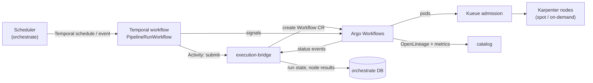
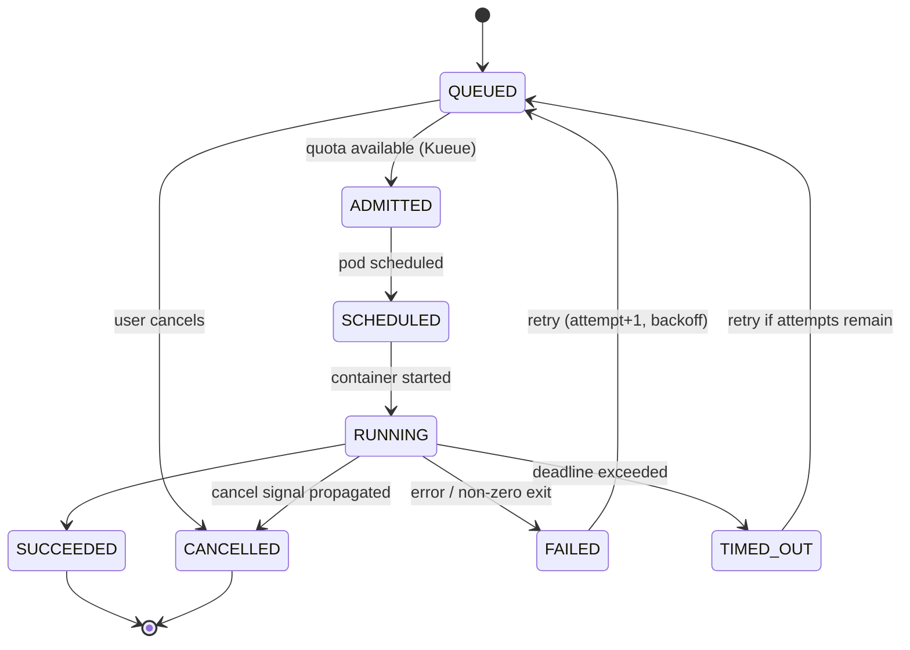
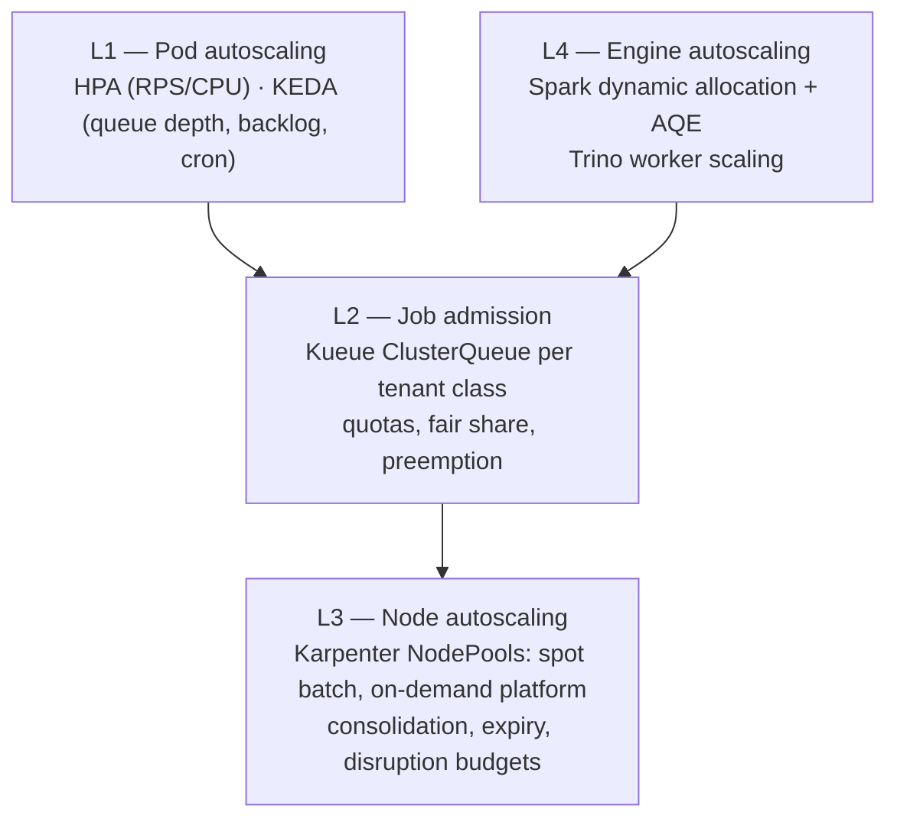

# 3. Orchestration, Scheduling, Async Execution and Autoscaling

> Covers FR-06, FR-07, FR-08, FR-12, FR-15. This is the heart of the "batch + scheduling + async + elastic"
> requirement, and the area with the most opportunity for accidental complexity.

---

## 3.1 Ownership model (the critical boundary)

Two orchestrators is a smell unless the seam is explicit. Ours is:

| Concern | Owner | Never done by |
|---|---|---|
| Durable state of a long-running operation | **Temporal** | Argo, `orchestrate` DB alone |
| Retries with backoff, timeouts, compensation | **Temporal** | Argo `retryStrategy` for business retries |
| Human-in-the-loop, approvals, long timers (days) | **Temporal** | Argo (no durable timer semantics) |
| Multi-step container DAG with data dependencies | **Argo Workflows** | Temporal (would reimplement a DAG engine) |
| Per-step pod lifecycle, artifacts, resource requests | **Argo** | Temporal |
| Cron/event/dependency scheduling semantics | **`orchestrate` scheduler** | Argo `CronWorkflow`, Temporal cron |
| Definition versioning, quotas, API, UI, audit | **`orchestrate`** | either engine |
| Multi-tenant admission, fair sharing, preemption | **Kueue** | namespaces only |

**Rules**

1. Temporal *may* submit and await an Argo Workflow. Argo *never* starts a Temporal workflow.
2. There is exactly **one** scheduler: `orchestrate`. Argo `CronWorkflow` and Temporal cron are disabled — they
   fragment backfill, SLA and concurrency semantics.
3. Every engine-level run carries `edp_run_id`; the `orchestrate` database is the **source of truth for run
   state**, reconciled from engine events (never the other way around).



---

## 3.2 Job and run model

### Resource hierarchy

```text
Pipeline (definition container)
  └── PipelineVersion (immutable, content-hashed)
        └── JobDefinition (a runnable unit: spark | dbt | sql | python | connector | container)
              └── JobRun (one execution, logical date, params, idempotency key)
                    ├── Attempt (retry #n)
                    └── TaskRun (per DAG node / per step)
```

### Run state machine



Terminal states are immutable. A "re-run" always creates a **new** `JobRun` linked by `rerun_of`.

### Invariants

- `JobRun.idempotency_key` is unique per `(job_definition, logical_date, params_hash)`.
- `PipelineVersion.spec_hash` covers the full spec; editing a pipeline creates a new version, never mutates.
- Every state transition is an append-only `run_event` row (also emitted to the event bus).
- A run can only move forward; illegal transitions are rejected at the service layer, not the DB.
- Cancellation is cooperative: signal → `SIGTERM` → grace 120 s → `SIGKILL`; artifacts preserved.

---

## 3.3 Scheduler semantics

Implemented in `orchestrate` as a leader-elected service that evaluates schedules every 15 s and creates
Temporal schedules/workflow starts. All times stored UTC; evaluation in the schedule's IANA timezone.

| Feature | Semantics |
|---|---|
| Cron | 5-field Vixie + `@daily`/`@weekly` macros; **timezone required** |
| Fixed rate | `every: 15m`, aligned to epoch or to a reference time |
| Calendar | Business days, holiday calendars per country, fiscal periods (`last_business_day_of_month`) |
| Event trigger | S3 object created, webhook, Kafka topic, catalog event, "dataset updated" |
| Dependency trigger | Upstream dataset freshness + optional quality gate (`run after gold_x succeeded`) |
| Sensor | Poll a condition (file exists, API returns ready) with backoff and max duration |
| Manual | Ad-hoc run with parameter override, always `force`-flagged for audit |
| Catch-up | `none` (skip missed), `one` (latest missed), `all` (backfill each missed interval) |
| Concurrency | `allow`, `forbid` (skip if running), `replace` (cancel running) — per pipeline or per partition |
| Backfill | Parameterized date range, chunked into runs, throttled by `max_parallel`, resumable |
| SLA | Deadline relative to schedule (`by 07:00 local`) or duration; `on_miss: notify \| escalate \| auto_retry` |
| Jitter | Optional ±N minutes to avoid thundering herd on shared sources |
| Blackout | Windows where runs are skipped or queued (month-end freeze, source maintenance) |
| Pause | Per pipeline or per tenant; queue holds, no new runs created |
| DST | Ambiguous local times run once at the earlier instant; nonexistent times skipped (documented + tested) |

### Idempotent backfill

Backfills reuse the same `PipelineVersion`, override `logical_date`, and write with **dynamic partition
overwrite** (`INSERT OVERWRITE ... PARTITION`) so a re-run of 2025-03-01 replaces exactly that partition.
The scheduler chunks a 2-year backfill into daily runs with `max_parallel: 4` and a shared `backfill_id` for
group cancellation and progress reporting.

### Data intervals vs processing time

Every scheduled pipeline declares `data_interval: [start, end)` derived from `logical_date`. Templates expose
`{{ .data_interval_start }}` / `{{ .data_interval_end }}`. This is what makes backfills and retries
deterministic — the number one source of duplicate data in naive schedulers.

---

## 3.4 Async task execution

### API contract

All long operations follow the same pattern:

```http
POST /v1/ingestions/{id}/runs
Idempotency-Key: 01J8Z9K3T7...
Prefer: respond-async
→ 202 Accepted
{
  "id": "run_01J8Z9K3T7",
  "status": "QUEUED",
  "links": {
    "self": "/v1/runs/run_01J8Z9K3T7",
    "events": "/v1/runs/run_01J8Z9K3T7/events",
    "cancel": "/v1/runs/run_01J8Z9K3T7/cancel"
  }
}
```

- `GET /runs/{id}` — current state, attempts, timings, error summary.
- `GET /runs/{id}/events` — SSE stream (`state`, `progress`, `log`, `metric`), resumable via `Last-Event-ID`.
- `POST /runs/{id}/cancel` — idempotent; returns `202` until terminal.
- Webhooks (`run.succeeded`, `run.failed`) with HMAC signature, retries 5× exponential, DLQ.

### Durable workflow patterns

| Pattern | Use | Implementation |
|---|---|---|
| Saga | Ingestion: fetch → validate → commit → catalog → notify | Temporal workflow with compensating activities (delete staged files on failure) |
| Human approval | Access request, production promotion, PII export | Temporal signal + 7-day timer + escalation |
| Long poll | "Wait until source file appears" | Temporal activity with heartbeat + `ContinueAsNew` after 24 h |
| Fan-out/fan-in | 500 folders in one ingestion | `workflow.ExecuteActivity` in batches, bounded by a semaphore |
| Throttled queue | Per-source rate limits | Temporal task queue + worker-side token bucket in Redis |
| Timer | Daily re-ACL sync, embedding model refresh | Temporal schedule |
| Child workflow | Per-partition run inside a backfill | Child workflow with parent close policy `ABANDON` on cancel |

**Why Temporal and not "K8s Job + a DB table"?** Because the failure modes of a 6-hour, multi-step, resumable
ingestion (pod eviction, source 429s, human approval, partial commits) are precisely what a durable execution
engine solves. Reimplementing retries and state reconciliation is where platforms go to die.

### Worker topology

| Task queue | Workers | Concurrency | Notes |
|---|---|---|---|
| `ingest-control` | `ingest-worker` (2–20 pods, KEDA on backlog) | 200 activities/pod | Orchestration only; cheap |
| `connector-<class>` | connector pods (0–300, KEDA) | 1 run/pod | Memory-heavy, spot-friendly |
| `transform-control` | `orchestrate` workers | 100 | Submits Argo, polls status |
| `document` | doc-processor pods | 4 docs/pod | CPU + model latency bound |
| `governance` | `govern` workers | 50 | ACL sync, classification |

Separate task queues per connector class prevent a slow SFTP run from starving SharePoint work.

---

## 3.5 Batch execution on Kubernetes

### Pipeline definition → Argo

A `PipelineVersion` compiles deterministically to an Argo `WorkflowTemplate` (stored as a ConfigMap/artifact,
version-pinned). Example DAG:

```yaml
# specs/job-spec.example.yaml (abridged)
apiVersion: orchestrate.edp.example/v1
kind: Pipeline
metadata: { name: finance-ar-daily, tenant: acme }
spec:
  schedule: { cron: "0 3 * * *", timezone: America/New_York, catchup: one }
  concurrency: forbid
  sla: { deadline: "07:00", onMiss: escalate }
  tasks:
    - id: bronze
      type: ingestion
      ingestion: acme-box-invoices
    - id: silver
      type: dbt
      dependsOn: [bronze]
      command: ["dbt", "run", "--select", "tag:ar"]
    - id: quality
      type: quality
      dependsOn: [silver]
      suite: acme.finance.silver_invoice_lines
    - id: gold
      type: spark
      dependsOn: [quality]
      mainApplicationFile: s3://edp-artifacts/acme/ar_aging.py
      args: ["--date", "{{ .data_interval_end | date \"2006-01-02\" }}"]
    - id: publish
      type: catalog
      dependsOn: [gold]
      datasets: [acme.finance.gold_ar_aging_daily]
```

### Execution types

| Type | Runtime | Typical use | Autoscaling |
|---|---|---|---|
| `spark` | Spark Operator, cluster mode | Large joins, CDC merge, backfills | Dynamic allocation + Karpenter |
| `dbt` | dbt-core container | SQL transforms, tests, docs | Pod per run, KEDA |
| `sql` | Trino client | DDL, `MERGE`, optimization | N/A (Trino cluster scales) |
| `python` | Polars/Pandas container | Small transforms, API enrichment | KEDA |
| `container` | Any signed image | Custom ML, vendor tools | KEDA/HPA |
| `ingestion` | Connector pod | Source ingestion | KEDA |
| `quality` | Soda/dbt test container | Gates | Pod per run |

### Pod defaults (enforced by Kyverno)

```yaml
resources: { requests: { cpu: 500m, memory: 1Gi }, limits: { cpu: 4, memory: 8Gi } }
securityContext:
  runAsNonRoot: true
  readOnlyRootFilesystem: true
  allowPrivilegeEscalation: false
  capabilities: { drop: ["ALL"] }
  seccompProfile: { type: RuntimeDefault }
activeDeadlineSeconds: 43200
ttlSecondsAfterFinished: 86400
```

No `latest` tags (Kyverno blocks), images must be signed and from the internal registry, service account
tokens not auto-mounted unless needed.

---

## 3.6 Autoscaling (four layers)



### L1 — Pod autoscaling

| Workload | Scaler | Metric | Range |
|---|---|---|---|
| API services | HPA | CPU 70% / RPS 200 | 3–30 |
| Temporal workers | KEDA | Temporal task-queue backlog (via Prometheus) | 2–40 |
| Connector pods | KEDA | SQS `ApproximateNumberOfMessages` / active runs | 0–300 |
| Doc processors | KEDA | SQS depth + age of oldest message | 0–100 |
| Web/BFF | HPA | RPS + p95 latency | 2–20 |

Scale-to-zero is allowed only for connector and doc-processor pools (cold start ≤ 25 s). API services keep a
minimum of 3 replicas across AZs.

### L2 — Kueue: quotas and fair sharing

```yaml
apiVersion: kueue.x-k8s.io/v1beta1
kind: ClusterQueue
metadata: { name: tenant-gold }
spec:
  namespaceSelector: { matchLabels: { quota-class: gold } }
  resourceGroups:
    - coveredResources: ["cpu", "memory", "nvidia.com/gpu"]
      flavors:
        - { name: spot, resources: [{ name: cpu, nominalQuota: 400 }, { name: memory, nominalQuota: 1Ti }] }
        - { name: on-demand, resources: [{ name: cpu, nominalQuota: 80 }, { name: memory, nominalQuota: 200Gi }] }
  cohort: shared-batch          # borrows idle quota from other tenants
  preemption:
    withinClusterQueue: LowerPriority
    reclaimWithinCohort: Any
```

- Three classes: `platinum` (on-demand, 24/7), `gold` (spot + on-demand burst), `standard` (spot, preemptible).
- Pipeline `priority` (0–9) maps to a `WorkloadPriorityClass` value of `priority × 100` (tier-1 SLA = 900,
  backfill = 100).
- Workloads are labeled with `tenant`, `priority` (0–9), `pipeline`. Lower-priority backfills are preempted by
  SLA-bearing daily runs — this is the single most effective cost/performance lever.
- Kueue is the **only** admission path for batch pods; direct `kubectl apply` in `edp-jobs` is blocked by policy.

### L3 — Karpenter

| NodePool | Capacity | Instance families | Taint | Consolidation |
|---|---|---|---|---|
| `system` | on-demand | m6i/m7i large | `CriticalAddonsOnly` | off |
| `platform` | on-demand | m6i/m7i xlarge | none | 30 s |
| `batch-spot` | spot (70% target) | c6i/c7i/m6i/m7i 2xl–8xl | `spot=true:NoSchedule` | 30 s, `expireAfter: 720h` |
| `batch-ondemand` | on-demand | same | `spot=false` | 60 s |
| `gpu` | on-demand | g5/g6 | `nvidia.com/gpu` | off |

Disruption budget `maxUnavailable: 10%` for platform; `WhenEmpty` for batch so a pod is never evicted mid-run
without checkpoint. Pods opt into spot via tolerations only if they checkpoint (connectors, Spark executors).

### L4 — Engine level

- **Spark:** dynamic allocation on (`minExecutors 2`, `maxExecutors` from quota), `spark.sql.adaptive.enabled`,
  shuffle tracking on K8s, executor pods on spot with `podTemplate` tolerations.
- **Trino:** worker groups; scale on queued queries and heap pressure; separate pool for ETL vs interactive.
- **dbt:** thread count from pod CPU limit (`threads = 4 × vCPU`), never larger than warehouse concurrency.

### Cost guardrails

1. Mandatory requests/limits + LimitRange per namespace; VPA in recommendation-only mode.
2. Every pipeline carries `cost_center`; `usage-meter` joins pod-seconds × instance price into showback.
3. `ttlSecondsAfterFinished` 24 h, artifact retention 90 d, Argo workflow GC on.
4. Backfills default to spot + low priority; the UI shows estimated cost before launching.
5. Idle dev/stage namespaces scale to zero nightly; prod never does.
6. Monthly budget alerts per tenant at 80/100/120% with automatic throttle at 120% (configurable).

---

## 3.7 Reliability patterns

| Failure | Detection | Response |
|---|---|---|
| Pod evicted (spot) | Argo node phase `Error`, exit 137 | Retry once on on-demand (`retryStrategy` node selector override), checkpoint resume |
| Source throttling (429) | Connector error code `RATE_LIMITED` | Exponential backoff + jitter, reduce parallelism, honor `Retry-After` |
| Poison record | Repeated failure on same offset | Skip + DLQ with payload sample; run continues, quality gate fails |
| Schema drift | Validation mismatch | Quarantine run, notify owner, do **not** auto-evolve unless contract allows |
| Stuck run | No heartbeat > 5 min | Temporal activity timeout → retry; UI shows `STALLED` |
| Partial commit | Bronze commit fails after staging | Staging GC; no visible dataset change (atomic Iceberg commit) |
| Downstream SLA miss | Scheduler deadline check | Escalation, auto-retry with priority boost, incident in `notify` |
| Engine outage | Temporal/Argo health | Runs queue durably; scheduler pauses creation; UI banner |

**Dead-letter queue:** every async pipeline has a DLQ topic/bucket with replay tooling (`edp dlq replay --id`).

---

## 3.8 SLOs and capacity

| SLI | Target |
|---|---|
| Schedule trigger → first pod running (p95) | < 10 s |
| Queue wait at baseline load (p95) | < 2 min |
| Run success rate (excluding data-quality failures) | ≥ 99% |
| SLA-bearing runs on time | ≥ 99.5% |
| Orchestrator API availability | 99.9% |
| Cancellation completes | < 60 s (p95) |
| Duplicate-data incidents | 0 per quarter |

**Capacity math (baseline):** 15k runs/day ≈ 10.4 runs/min average, 60/min at peak. At 2 min average runtime
and 400 pods peak, Kueue quota of 500 vCPU for `gold` + 1,200 vCPU for `standard` spot covers p99 with
headroom. Recompute from measured `run_seconds` distribution monthly.

---

## 3.9 Anti-patterns we explicitly avoid

- A cron daemon per team, or cron in a container (`while true; sleep`).
- Argo `CronWorkflow` **and** platform schedules for the same pipeline.
- Business retries inside Argo retry loops (no durable state, no backoff across hours).
- Long-running synchronous HTTP calls to trigger pipelines.
- One giant "platform" namespace where a runaway job starves the control plane.
- Auto-scaling to zero for anything on the critical path of an SLA.
- Treating spot eviction as an error rather than an expected event.
