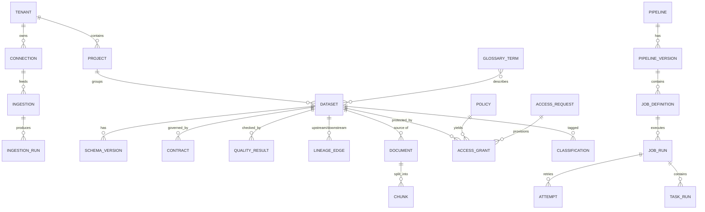
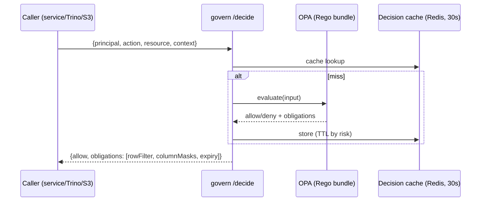
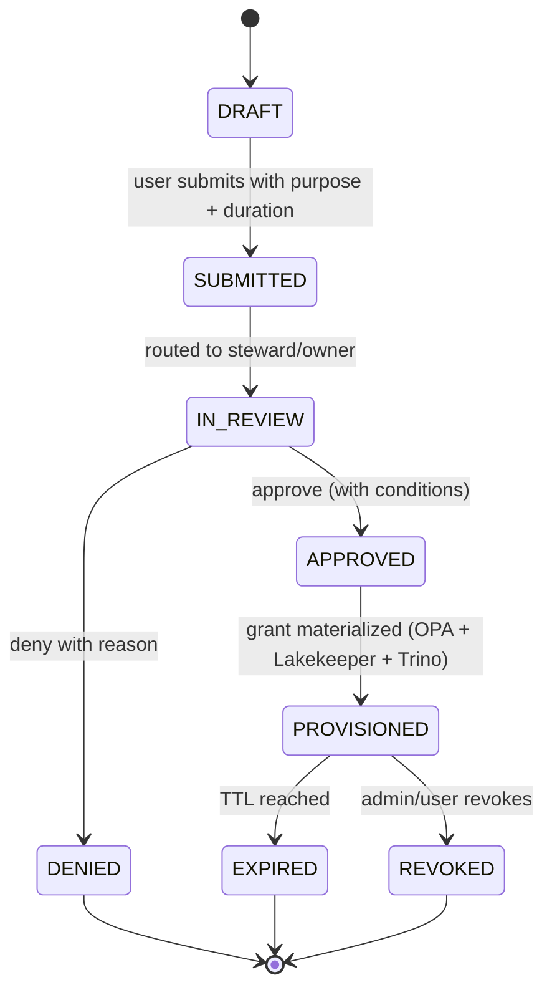

# 4. Metadata, Security and Permission Governance

> Covers FR-09, FR-10. NFR-05, NFR-07. This is the layer that makes the platform trustworthy enough for
> regulated data — and the one most often built as an afterthought.

---

## 4.1 Metadata architecture

**Principle:** *operational metadata is owned by the platform; business metadata is owned by the catalog.*

| Metadata domain | System of record | Consumers | Write path |
|---|---|---|---|
| Tenants, users, groups, projects | `iam` (Postgres) | everything | API, SCIM |
| Connections, credential refs | `connect` (Postgres) | `ingest`, UI | API |
| Ingestion definitions, watermarks | `ingest` (Postgres) | scheduler, UI | API |
| Pipelines, versions, runs, attempts | `orchestrate` (Postgres) | UI, audit, catalog | API + engine events |
| Assets, datasets, schema versions | `catalog` (Postgres) | Trino, BI, AI | API + OpenLineage |
| Data contracts, quality results | `catalog` (Postgres) | CI, pipelines | API + checks |
| Lineage edges (hot, queryable) | `catalog` (Postgres) | UI, impact analysis | `lineage-collector` |
| Business glossary, descriptions, ownership, tags | **OpenMetadata** | UI, search, AI | `catalog` → OM API |
| Classifications / PII findings | `govern` + OM tags | policies, UI | scanners + API |
| Policies, grants, access requests | `govern` (Postgres) + OPA bundles (Git) | all enforcement points | API + GitOps |
| Audit events | `audit` (Postgres → S3 hash-chained) | SIEM, compliance | outbox → consumer |
| Search index | OpenSearch | UI, MCP | indexer from events |
| Vectors | OpenSearch k-NN | `assist` | doc pipeline |

**No dual writes.** Every cross-domain sync goes through the transactional outbox → event bus → idempotent
consumer. If OpenMetadata is unavailable, the platform keeps working; the catalog-sync consumer retries and
reconciles with a periodic full-diff job.

### Entity model (simplified)



### Asset identity

- `asset_id` (UUIDv7) is the internal key.
- `urn = urn:edp:{tenant}:{domain}:{layer}.{name}` is the stable public identifier used in lineage, policies
  and APIs.
- Renames are metadata operations: `name` changes, `urn` does not. Deprecation is a state, not a delete.
- Every asset has `owner`, `steward`, `domain`, `criticality` (tier 1–4), `classification`, `lifecycle_state`
  (`draft|active|deprecated|archived`). Assets missing owner/classification fail the "catalog complete" gate.

---

## 4.2 Lineage

### Capture

| Producer | Mechanism | Granularity |
|---|---|---|
| Connectors | Explicit `source → bronze` edges from the ingestion spec | Dataset + file/folder |
| Spark | OpenLineage Spark listener (column-level when plans expose it) | Dataset + column |
| dbt | `manifest.json` + `run_results.json` parsed post-run | Model + column (`ref`/`source`) |
| Trino | Query events + parsed SQL (sqlglot) | Table + column for CTAS/INSERT |
| Python/Polars | SDK decorator `@lineage(inputs, outputs)` | Dataset |
| Manual | API for external systems | Dataset |

All events are **OpenLineage 2.x** with `edp_run_id`, `tenant`, `job_namespace`, and `facets` for schema,
quality and ownership. `lineage-collector` validates, dedupes (`event_id`), writes edges to Postgres
(`catalog.lineage_edge`) and pushes to OpenMetadata.

### Use

- **Impact analysis:** "what breaks if I drop `silver_invoice_lines`?" — reverse traversal, depth ≤ 10,
  returns datasets, pipelines, dashboards (from OM), and ML models.
- **Root cause:** "why is `gold_ar_aging_daily` stale?" — walk upstream to the failing run.
- **Privacy propagation:** erasure requests traverse downstream edges to find copies (table, file, vector).
- **CI gate:** a new pipeline with an output dataset and no emitted lineage fails the pipeline test.

---

## 4.3 Classification and tagging

| Layer | Mechanism | Examples |
|---|---|---|
| Name/type heuristics | Column name + type + sample regex | `ssn`, `email`, `phone`, `dob`, `account_no` |
| Content scanning | AWS Macie (S3), Comprehend (text), Presidio (documents) | PII categories, confidence scores |
| Source signals | Sensitivity labels from M365/Box/Drive; column comments; Snowflake tags | `CONFIDENTIAL`, `INTERNAL` |
| Steward | Manual tag with justification + expiry | business-critical, deprecated, experimental |
| Derived | Rules ("any dataset joined to `customer_pii` inherits `PII`") | inherited classification |

Tag taxonomy (fixed, extensible by admin only):

| Tag | Meaning | Default handling |
|---|---|---|
| `PUBLIC` | Publishable externally | no restriction |
| `INTERNAL` | All employees | default for most data |
| `CONFIDENTIAL` | Need-to-know, named projects | explicit grant + purpose |
| `RESTRICTED` | Regulated (PII/PHI/PCI), legal exposure | mask by default, approval + justification, export blocked |
| `PII` / `PHI` / `PCI` | Regulatory categories | drives masking and retention |
| `LEGAL_HOLD` | Cannot delete | blocks retention jobs and erasure |

Classification results are **evidence, not truth**: each tag stores source, confidence, scanner version and
timestamp; a steward can override with a reason, and every override is audited.

---

## 4.4 Authorization model

### Model

**RBAC for coarse access, ABAC for the conditions that auditors actually ask about.**

```text
Principal  := user | group | service_account | tenant
Resource   := tenant | project | domain | dataset | column | row_scope | document | job | connection
Action     := read | write | ingest | query | export | administer | approve | train | delete
Role       := named set of (resource_pattern, action) bindings
Attribute  := classification | purpose | residency | time | network_zone | request_ttl
```

| Role | Typical holder | Grants |
|---|---|---|
| `PlatformAdmin` | platform team | cluster-wide config, no data read by default |
| `TenantAdmin` | BU admin | everything in tenant except `RESTRICTED` data |
| `DataSteward` | data office | classify, approve access, define glossary, no raw data unless granted |
| `DataEngineer` | engineering | create pipelines, write silver/gold, read bronze in domain |
| `Analyst` | business | read `INTERNAL`/`CONFIDENTIAL` in project, no `RESTRICTED` |
| `Scientist` | ML | read + sandbox write, export with approval |
| `Auditor` | risk/compliance | read audit + metadata, **not** data |
| `ServiceAccount` | automation | scoped, expiring, tenant-bound |

### Policy decision flow



Obligations matter more than the boolean: `rowFilter: "region = 'US'"`, `columnMasks: {ssn: "hash"}`,
`maxRows: 10000`, `watermark: "internal only"`.

### Example policy (Rego)

```rego
package edp.authz

default allow := false

# Analysts may read INTERNAL/CONFIDENTIAL data in their own tenant and project.
allow if {
    input.action == "read"
    input.principal.roles[_] == "Analyst"
    input.resource.tenant == input.principal.tenant
    input.resource.project == input.principal.project
    input.resource.classification in {"INTERNAL", "CONFIDENTIAL"}
    not input.resource.tags[_] == "LEGAL_HOLD"
}

# RESTRICTED requires an unexpired, purpose-bound grant.
allow if {
    input.action in {"read", "query"}
    some grant in input.principal.grants
    grant.resource_urn == input.resource.urn
    grant.expires_at > time.now_ns() / 1000000000
    grant.purpose == input.context.purpose
    input.context.mfa == true
}

# Column masks are obligations, not denials.
masks[column] := "sha256" if {
    input.resource.columns[column].classification == "RESTRICTED"
    input.resource.columns[column].pii == true
    not input.principal.roles[_] == "DataSteward"
}
```

Policies are **tested in CI** (`opa test`, `conftest`) and shipped as signed bundles. A policy change is a PR
with an approval from security, not a UI click.

### Enforcement points

| Point | What it enforces | Bypass risk |
|---|---|---|
| Envoy Gateway | AuthN, coarse scope, tenant routing | none (only ingress) |
| Each service | Resource-level RBAC/ABAC via `/decide` | service bug — mitigated by contract tests |
| Trino | Table/column/row policies, masks, catalog access | users with direct S3 access — blocked by bucket policy |
| Lakekeeper | Namespace/table grants for engines | must stay in sync with `govern` (reconciled hourly) |
| S3 bucket policy + STS session policy | Prefix-level read/write, denies non-platform roles | IAM misconfiguration — checked by `access-analyzer` job |
| OpenSearch | Tenant index isolation + ACL pre-filter on vectors | DLS misconfig — tested by security regression suite |
| Temporal | Namespace per isolation tier, mTLS | none |
| Kubernetes | Namespace RBAC, NetworkPolicy, PodSecurity | cluster-admin — break-glass only, audited |

**Rule:** the UI is a convenience, never a control. Every UI action maps to an API call that re-checks policy.

---

## 4.5 Multi-tenancy and isolation

| Tier | Compute | Storage | Keys | Network | Typical use |
|---|---|---|---|---|---|
| `shared` | Namespace, Kueue quota, priority class | Prefix + bucket policy | Tenant KMS key | NetworkPolicy egress allowlist | Default, internal BU |
| `isolated` | Dedicated node pool + taints, dedicated Kueue cohort | Dedicated bucket | Dedicated KMS key | Dedicated NAT/egress IPs | Regulated BU |
| `dedicated` | Separate EKS cluster, same control plane (federated) | Dedicated account | Dedicated key + HSM option | Separate VPC | Subsidiary, acquisition, sovereign |

Cross-tenant access is denied at three layers (policy, database RLS, storage prefix). Postgres uses
`tenant_id` on every table with RLS enabled and a session variable set by the service middleware; a missing
predicate returns zero rows rather than everything.

**Noisy neighbour controls:** per-tenant API rate limits (token bucket at gateway), Kueue quotas, Trino
resource groups, connector concurrency caps, OpenSearch index shard limits, and per-tenant S3 request quotas
via prefix-level monitoring.

---

## 4.6 Access requests and lifecycle



- Max default TTL: 30 days for `CONFIDENTIAL`, 7 days for `RESTRICTED`; permanent grants require a role, not
  a request.
- Approvals route by ownership in the catalog; delegation and out-of-office are supported.
- Every grant is a row with `granted_by`, `justification`, `purpose`, `expires_at`, `ticket_ref`.
- Revocation is immediate: the decision cache is invalidated by a `policy.changed` event; Trino re-evaluates
  per query; Lakekeeper grants are removed by a reconciler within 60 s.
- Bulk/role grants require a data owner + security approval (two-person rule).

---

## 4.7 Audit and privacy

### Audit

- **What:** every authentication, authorization decision, config change, run trigger, data export, secret
  access, policy change, admin action, and break-glass event.
- **Shape:** append-only, `event_id` + `prev_hash` hash chain per tenant; daily Merkle root written to S3 with
  Object Lock; export to SIEM (Splunk/Sentinel) within 60 s.
- **Who:** `audit` service is write-only for other services (no update/delete API exists), separate DB role.
- **Retention:** 7 years, immutable; metadata 13 months hot in OpenSearch, rest in S3 + Athena.
- **Access:** `Auditor` role can read; reading audit is itself audited.

### Privacy

| Obligation | Implementation |
|---|---|
| DSAR / access request | Search subjects by key/tag across lineage → assemble report → redact other subjects → deliver with audit |
| Right to erasure | Iceberg `DELETE` on silver/gold + raw object purge + vector reindex + downstream consumer notification via `dataset.erased` event |
| Retention | Per-dataset policy enforced by a scheduled job; `LEGAL_HOLD` blocks deletion |
| Purpose limitation | Grants carry `purpose`; queries without a matching purpose are denied for `RESTRICTED` |
| Minimization | Column masks and row filters by default; exports are watermarked and row-capped |
| Residency | Tenant pinned to a region; cross-region replication disabled for restricted tenants |
| Model training | `train` action is separate from `read`; dataset must have `ai_training_allowed=true` |

### Break-glass

Two-person approval, 1-hour TTL, full session recording (query text, rows accessed), automatic notification to
security, mandatory post-incident review. Implemented as a special grant type — not by disabling policy.

---

## 4.8 Key management and secrets

- **KMS:** one CMK per tenant per region; S3 SSE-KMS with bucket key; envelope encryption for vector metadata;
  key policy restricted to the platform roles; annual rotation.
- **Secrets:** only ARNs are stored in Postgres. ESO syncs into namespaced K8s Secrets with `refreshInterval:
  1h`; connector pods get file-mounted secrets, never env vars.
- **Per-user OAuth tokens** (Drive/OneDrive/SharePoint/Box delegated): encrypted with tenant CMK, stored per
  `(tenant, user, connection)`, refreshed by a token broker; access tokens live ≤ 60 min in memory only.
- **Workload identity:** IRSA for AWS access; SPIFFE/istio identities for service-to-service mTLS (phase 2).
- **No static AWS keys** anywhere; CI uses OIDC federation to AWS.

---

## 4.9 Compliance mapping (abbreviated)

| Control area | SOC 2 | ISO 27001 | Implementation |
|---|---|---|---|
| Logical access | CC6.1–6.3 | A.9 | SSO, RBAC/ABAC, least privilege, quarterly review |
| Change management | CC8.1 | A.12.1.2 | GitOps, PR approvals, signed artifacts, audit |
| Encryption | CC6.7 | A.10 | TLS 1.2+, KMS at rest, per-tenant keys |
| Monitoring | CC7.2 | A.12.4 | OTel, SIEM, alerting, 7-year audit |
| Vendor management | CC9.2 | A.15 | Sub-processor inventory, DPAs, region pinning |
| Incident response | CC7.3–7.5 | A.16 | Runbooks, on-call, postmortems, breach notification |
| Data retention | P4.2 | A.18 | Per-dataset policy, legal hold, erasure workflow |

HIPAA-capable (`isolated`/`dedicated` tiers, BAA-eligible services only) but not enabled by default.
