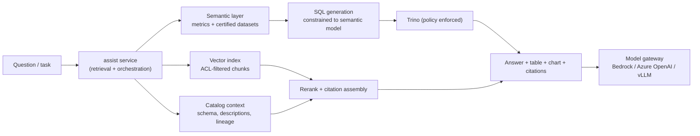

# 6. API, Experience Layer, MCP and AI/BI Enablement

> Covers FR-02, FR-13, FR-14 and the "business-user friendly" requirement. The API is the product; the UI is one
> client of it. That ordering is what makes MCP and AI agents viable later.

---

## 6.1 API conventions

| Concern | Convention |
|---|---|
| Style | REST/JSON, resource-oriented; OpenAPI 3.1 as the contract; generated TS/Python clients |
| Base path | `https://api.{env}.edp.example/v1` (version in path, additive changes only within a major) |
| Tenancy | From token claim (`tenant_id`), never from body; path may scope (`/v1/tenants/{t}/...`) for admins |
| AuthN | OIDC bearer (Entra ID/Okta); service tokens with 15-min TTL; mTLS for service-to-service |
| AuthZ | OAuth2 scopes (`catalog:read`, `ingest:write`, `runs:execute`, `admin`) **plus** ABAC evaluation |
| Idempotency | `Idempotency-Key` required on all `POST` that create state; 24 h dedupe window |
| Concurrency | `ETag` + `If-Match` on mutable resources; 412 on mismatch |
| Pagination | Cursor (`?cursor=...&limit=50`); stable ordering; total counts optional |
| Filtering | Explicit allowlisted fields (`?status=FAILED&owner=...`), no query language in v1 |
| Errors | RFC 9457 `application/problem+json` with `type`, `title`, `status`, `detail`, `instance`, `trace_id` |
| Async | `202` + `Location` + `Retry-After`; operation resource with `status`, `progress`, `links` |
| Rate limits | Per tenant + per endpoint class; `429` with `Retry-After`; quotas in `X-RateLimit-*` |
| Deprecation | `Deprecation` + `Sunset` headers, 6-month window, changelog in docs |
| Events | CloudEvents 1.0 over webhooks (HMAC-SHA256) and SSE for UI |
| Audit | Every mutating call produces an audit event with `actor`, `action`, `resource`, `diff_hash` |

### Endpoint map

| Domain | Endpoints |
|---|---|
| Identity | `GET /me`, `GET/POST /tenants`, `GET/POST /projects`, `GET /groups`, `POST /scim/v2/Users` |
| Connections | `GET/POST /connections`, `GET/PATCH/DELETE /connections/{id}`, `POST /connections/{id}:test`, `POST /connections/{id}:discover`, `GET /connections/{id}/resources` |
| Ingestion | `GET/POST /ingestions`, `POST /ingestions/{id}:validate`, `POST /ingestions/{id}:run`, `GET /ingestions/{id}/runs`, `GET /runs/{id}` |
| Pipelines | `GET/POST /pipelines`, `POST /pipelines/{id}:version`, `POST /pipelines/{id}:validate`, `GET /pipelines/{id}/versions` |
| Scheduling | `GET/POST /schedules`, `POST /schedules/{id}:pause`, `POST /schedules/{id}:resume`, `POST /backfills` |
| Runs | `GET /runs`, `GET /runs/{id}`, `POST /runs/{id}:cancel`, `GET /runs/{id}/events` (SSE), `GET /runs/{id}/logs` |
| Catalog | `GET /assets` (with `?q=` for keyword + semantic search), `GET /assets/{urn}`, `GET /datasets/{urn}/schema`, `GET /datasets/{urn}/lineage` |
| Contracts | `GET/POST /contracts`, `POST /contracts/{id}:validate`, `GET /contracts/{id}/violations` |
| Governance | `GET/POST /policies`, `POST /decide`, `GET/POST /access-requests`, `POST /access-requests/{id}:approve`, `POST /grants/{id}:revoke` |
| Config | `GET/POST /config/{kind}/{name}`, `POST /config/{kind}/{name}:apply`, `:rollback`, `:promote`, `GET /config/drift` |
| Notifications | `GET/POST /subscriptions`, `GET /deliveries` |
| Usage | `GET /usage?tenant=&period=`, `GET /usage/budgets` |
| Assist | `POST /assist/ask`, `POST /assist/search`, `GET /assist/conversations/{id}` |

Full contract: [`specs/openapi.yaml`](../specs/openapi.yaml) (core subset, generated clients in CI).

---

## 6.2 Experience layer

### Personas

| Persona | Goal | Success moment |
|---|---|---|
| **Business analyst (Priya)** | Get a new source's data into a dashboard without a ticket | Connects a Box folder, maps 6 columns, schedules daily, sees data in Power BI same day |
| **Data steward (Marcus)** | Know what exists, who owns it, who can see it | Answers an auditor in 5 minutes with lineage + grant history |
| **Data engineer (Dana)** | Build reliable pipelines without babysitting | Writes a pipeline once, gets alerts only on real problems |
| **Data scientist (Sam)** | Find governed training data and documents | Searches catalog, requests access, gets approved in hours |
| **Platform admin (Alex)** | Keep it running and affordable | Sees tenant cost, quotas and failures on one page |
| **AI agent** | Answer questions with governed data | Calls MCP tools, gets ACL-filtered results with citations |

### IA / navigation

```text
Home (activity, my requests, failing runs)
├── Catalog        search · datasets · documents · glossary · lineage · quality
├── Ingest         connections · sources · ingestion wizard · runs
├── Build          pipelines · transformations · schedules · backfills
├── Monitor        runs · SLA · alerts · logs
├── Govern         access requests · policies · classifications · audit
└── Admin          tenants · projects · quotas · cost · config · settings
```

### Ingestion wizard (the core business-user flow)

```text
┌─ New ingestion ─────────────────────────────────────────────────────────────┐
│ 1 Source   2 Discover   3 Map   4 Validate   5 Schedule   6 Review          │
├─────────────────────────────────────────────────────────────────────────────┤
│ Source type:  [Box] [SharePoint] [OneDrive] [Google Drive] [SFTP] [REST] …  │
│                                                                             │
│ Connection   box-finance        [+ New connection]   ✓ Connected 42 ms      │
│ Folder       /Invoices/2026     [Browse…]                                   │
│                                                                             │
│ ┌ Preview ────────────────────────────────────────────────────────────────┐ │
│ │ invoice_id   vendor_name      amount_usd   invoice_date   file          │ │
│ │ INV-1042     Acme Supplies    1,240.00     2026-10-01     a.pdf         │ │
│ │ INV-1043     Northwind        980.50       2026-10-01     b.pdf         │ │
│ └─────────────────────────────────────────────────────────────────────────┘ │
│                                                                             │
│ Target dataset  acme.finance.bronze_invoices   (auto-suggested)             │
│ Contract        ✓ 6 columns matched · 1 new column will be added (additive) │
│ Schedule        ● Daily at 02:00 America/New_York   ○ Hourly   ○ On change  │
│                                                                             │
│                          [Back]  [Validate & continue →]                    │
└─────────────────────────────────────────────────────────────────────────────┘
```

Interaction rules:

- **Progressive disclosure.** Five fields before the preview; advanced options (rate limits, watermarks,
  partition strategy) behind "Advanced".
- **Always show the consequence.** "This will create a new dataset", "This changes the schedule for 3
  downstream pipelines", "This column contains PII — it will be masked for Analysts".
- **Never block on an empty catalog.** If no contract exists, offer "infer contract from sample" with a
  review step.
- **Dry run first.** "Validate" executes discovery + schema check + quality sample, not a full ingestion.
- **Explain failures in business language.** "Box rejected the request: the app needs `item.read` permission"
  with a deep link, not a stack trace.
- **Accessibility:** WCAG 2.2 AA, keyboard-first for data grids, no color-only status.

### Key journeys

| Journey | Steps | Time target |
|---|---|---|
| Onboard a source | Create connection → test → discover → map → validate → schedule | < 15 min |
| Ingest a file drop | Point at folder → preview → schedule on change | < 5 min |
| Find data | Search (keyword + semantic) → dataset page (schema, owner, lineage, quality) → request access | < 2 min |
| Request access | Select columns → purpose → duration → submit → approve → auto-provision | < 1 business day |
| Investigate failure | Alert → run page → failing step → logs → suggested fix → retry | < 10 min |
| Build a pipeline | Start from template (bronze→silver→gold) → select datasets → schedule → validate | < 30 min |

### Frontend architecture

- **Next.js 15 App Router**, server components for catalog pages (SEO-free but fast), client components for
  wizard and live run stream.
- BFF aggregates cross-service reads; the browser never calls more than one origin.
- State: TanStack Query; real-time via SSE with reconnect; optimistic UI only for safe actions.
- Design system: Tailwind + shadcn/ui + a token layer for tenant branding; dark mode; density toggle for grids.
- Heavy grid (lineage, runs) virtualized; lineage graph rendered with a WebGL/canvas library for > 500 nodes.
- Feature flags per tenant (`configure`) for gradual rollout.

---

## 6.3 MCP: both directions

### Platform as MCP **server** (AI agents consume the platform)

Endpoint: `POST /mcp` (Streamable HTTP), OAuth 2.1 resource server; the token carries the same scopes and
tenant as any other client. Every tool call is authorized by `govern` and audited with the agent identity.

| Tool | Purpose | Guardrails |
|---|---|---|
| `search_catalog` | Semantic + keyword search over datasets/documents | Tenant + ACL filter applied server-side |
| `get_dataset` | Schema, owner, quality, freshness, classification | Column visibility rules applied |
| `get_lineage` | Upstream/downstream, depth ≤ 3 | Classified assets redacted |
| `query_dataset` | Run a read-only SQL query against a certified dataset/view | Row limit 10k, statement timeout 60 s, no DDL/DML, cost cap, result watermarking |
| `list_documents` / `read_document` | Retrieve governed document chunks | ACL + classification pre-filter; PII redaction |
| `check_job` | Status of a run | Tenant-scoped |
| `request_access` | Open an access request on behalf of the user | Requires user confirmation; never auto-approved |
| `create_ingestion_draft` | Draft (not apply) an ingestion from a natural-language description | Draft only; human must review and apply |
| `ask_data` | Natural-language question → governed SQL → answer + chart spec | Uses semantic layer; refuses uncertified data |

**Deliberately excluded:** arbitrary write, pipeline execution, secret access, policy changes. Agents propose;
humans approve.

### Platform as MCP **client** (external MCP servers as sources)

A connector family (`mcp`) with allowlisted servers per tenant:

- Transport: Streamable HTTP (remote) or stdio via `remote-agent` (local tools).
- Discovery: `tools/list` + `resources/list`, mapped to `Resource` with JSON Schema.
- Read: tool invocation with a read-only profile; output size cap (10 MB); pagination if supported.
- Safety: tool allowlist, no filesystem/network tools, per-call timeout, prompt-injection screening on returned
  content before it reaches an LLM, full trace of arguments/results (redacted).

---

## 6.4 BI enablement

| Concern | Approach |
|---|---|
| Access | BI tools connect to Trino via JDBC/ODBC with a service account; per-user identity passed where supported (`X-Trino-User` + JWT) |
| Models | Gold tables + **semantic views** (`gold_*_semantic`) that encode joins, grain and certified metrics |
| Metrics | Defined once in dbt (MetricFlow) or Cube; BI tools are discouraged from redefining business logic |
| Performance | Pre-aggregated gold tables, Trino result cache, materialized views for dashboards > 10k queries/day |
| Freshness | Dataset page shows `last_updated`, SLA status, and the pipeline that produces it |
| Lineage | "Used by" dashboards (from OM/BI metadata ingestion) so impact analysis covers reports |
| Self-service | Analysts get sandbox schemas + curated gold; promotion to gold requires a contract + review |
| Certification | `certified: true` badge only for datasets with owner, contract, tests, SLA and a documented definition |

**Anti-pattern guarded against:** BI tools querying bronze or raw. Those schemas are not granted to BI service
accounts; only silver/gold and semantic views are.

---

## 6.5 AI enablement

### Architecture



### Capabilities

| Capability | How it works | Guardrail |
|---|---|---|
| Semantic search | Hybrid BM25 + k-NN over datasets and documents; rerank top 50 | ACL pre-filter, classification redaction |
| "Ask your data" | NL → semantic-layer query → Trino → answer + chart | Only certified metrics; SQL shown to user; row caps |
| Document Q&A (RAG) | ACL-filtered chunks → LLM with citations to document + page | Refuse if no grounded passage; no free-form web access |
| Pipeline copilot | Draft YAML for ingestion/pipeline from description + catalog context | Draft only; validated before apply |
| Schema mapping suggestions | Embedding similarity between source columns and contract fields | Human confirms; confidence shown |
| Failure explanation | Run logs + error taxonomy → plain-language cause + fix | Read-only; no auto-remediation in v1 |
| Data steward assistant | Summarize lineage, flag unclassified PII, draft descriptions | Suggestions require steward approval |

### Guardrails (non-negotiable)

1. **Policy before retrieval.** No chunk or row enters the prompt unless the caller is authorized for it.
2. **Citations or refusal.** Every factual claim links to a dataset/query id or a document chunk.
3. **Prompt injection defense.** Retrieved content is untrusted data: strip instructions, delimit, never let it
   select tools, allowlist tool calls.
4. **PII minimization.** Redact before embedding and before sending to the model; log redaction counts.
5. **Model gateway.** Central egress for all LLM calls: routing, retries, token budgets per tenant, cost
   tracking, prompt/response logging (opt-in, redacted), no direct provider keys in services.
6. **Evaluation.** Golden set of 300 Q/A pairs per domain; CI gate on groundedness, answer relevance, SQL
   correctness, and policy compliance (0 unauthorized rows).
7. **Human in the loop** for anything that writes (ingestion, pipeline, access grant).

### Model and vector choices

- Embeddings: Bedrock Titan Text v2 (default), Cohere Embed v3 (multilingual), OpenAI (if approved). Stored with
  model id + version; index alias per model version.
- Generation: Claude via Bedrock (default), GPT via Azure OpenAI (approved tenants), vLLM on-prem (isolated
  tenants). Chosen per tenant by policy, not by prompt.
- Vector store: OpenSearch k-NN (HNSW, cosine). Index per tenant, alias per embedding version, replicas per AZ.

---

## 6.6 Event and webhook catalog (summary)

| Event | Producer | Consumers |
|---|---|---|
| `connection.discovered` | connect | UI, catalog |
| `ingestion.run.started/succeeded/failed` | ingest | UI, notify, catalog, audit |
| `dataset.version.created` | catalog | BI cache, AI index, downstream pipelines |
| `dataset.schema.changed` | catalog | contracts CI, notify, consumers |
| `dataset.quality.failed` | catalog | notify, scheduler gate |
| `pipeline.run.started/succeeded/failed` | orchestrate | UI, notify, audit |
| `policy.changed` / `grant.revoked` | govern | all PDP caches, Trino, Lakekeeper |
| `access.request.approved` | govern | provisioning, notify |
| `config.applied` | configure | services (hot reload), audit |
| `document.indexed` | assist | catalog, search |
| `usage.threshold.reached` | usage-meter | notify, throttle |

Envelope and schema rules: [`specs/events.md`](../specs/events.md).
