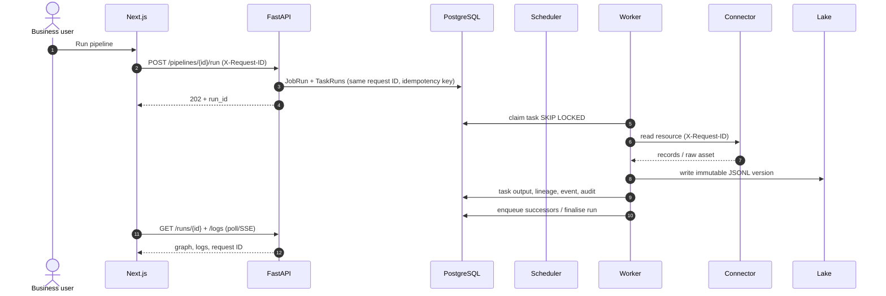
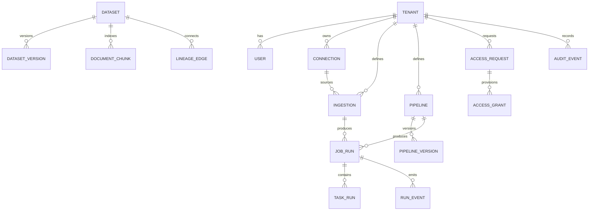
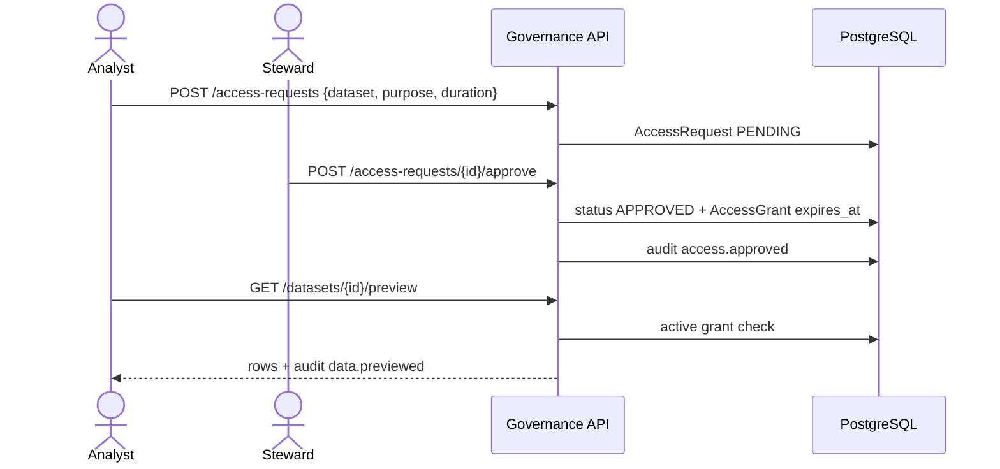

# 9. Reference Product — Implementation and Requirements Traceability

> **Status:** runnable reference implementation v0.1 · **Scope:** the product under
> `services/platform-api`, `packages/connector-sdk`, `apps/web`, `deploy/compose` and `deploy/k8s`.
> **Design target:** docs 01–08. This document is explicit about the gap between the two.

---

## 9.1 What was built

Meridian's reference product is a working vertical slice of the platform: a business user can connect a
source, discover its resources, create and schedule an ingestion, see the landed dataset in the catalog,
build a DAG, run and debug it, approve access to restricted data, and ask a cited question over governed
documents — entirely from the web console or CLI.

It is a **modular service chassis** deployed as four roles:

| Role | Process | Responsibility | Scale |
|---|---|---|---|
| `api` | `uvicorn meridian.main:app` | REST/SSE/WebSocket control plane, UI BFF, auth, audit, catalog, RAG | HPA on CPU/memory; stateless |
| `scheduler` | `python -m meridian.engine.scheduler` | materialise due schedules into DAG runs; one run per logical date | 1 replica; DB advisory lock |
| `worker` | `python -m meridian.engine.worker` | lease and execute tasks; write dataset versions, lineage and JSONL logs | N replicas; `SKIP LOCKED` |
| `web` | Next.js standalone server | enterprise console | 2+ replicas |

Everything shares PostgreSQL for metadata/queue/audit and object storage (local volume or S3) for payloads.
There is no Redis, broker or Temporal dependency in this slice. The state machine and ports are designed so
the in-process executor can be replaced by Temporal/Argo without changing the pipeline or API contracts.

### Implementation inventory

| Area | Files |
|---|---|
| API routes | `services/platform-api/src/meridian/api/*.py` |
| Domain / persistence | `models.py`, `serializers.py`, `schemas.py`, `services/*.py` |
| DAG engine | `engine/dag.py`, `engine/tasks.py`, `engine/worker.py`, `engine/scheduler.py` |
| Connector SDK | `packages/connector-sdk/src/edp_connector_sdk/*` |
| Built-in connectors | `meridian/connectors/{filesystem,http,postgres,s3,sftp,mongodb,cloud_drives}.py` |
| Parsers | `parsers.py` (CSV, JSON, JSONL, XML, XLSX, PDF, DOCX, HTML, text) |
| Security / audit | `security.py`, `audit.py`, `api/governance.py` |
| Observability | `logging_setup.py`, `telemetry.py` |
| CLI | `cli.py` |
| Web console | `apps/web/src/app/**`, `apps/web/src/components/**` |
| Local stack | `deploy/compose/app.yaml` |
| Kubernetes / EKS | `deploy/k8s/*`, `deploy/eks/*` |
| Tests / verification | `services/platform-api/tests/*`, `scripts/smoke.py` |

---

## 9.2 Requirements traceability

The ten numbered criteria in the brief, plus the named UI capabilities, map as follows.

### 1. Relational metadata persistence

| Requirement | Implementation | Evidence |
|---|---|---|
| Persistent metadata in a relational database | SQLAlchemy 2 models on PostgreSQL 16; SQLite for local tests | `models.py`, `db.py`; Compose `postgres` |
| Datasets, schemas, versions, lineage, runs, tasks, events | `Dataset`, `DatasetVersion`, `LineageEdge`, `JobRun`, `TaskRun`, `RunEvent` | catalog and run APIs |
| Audit and governance | `AuditEvent` hash chain, `AccessRequest`, `AccessGrant` | `/governance/*` |
| Tenant scoping | every entity carries `tenant_id`; repository queries filter it | API tests + `deps.py` |
| Concurrency | optimistic pipeline versions; `JobRun.idempotency_key` unique; queue leases | `engine/dag.py` |
| Indexes | tenant/status/time indexes; queue index on `(status, available_at)` | `models.py` |

### 2. Metadata management and connector architecture

| Requirement | Implementation | Evidence |
|---|---|---|
| Connector contract | dependency-free SDK: `Connector`, `Resource`, `RecordBatch`, `RawAsset`, `ConnectorContext`, entry-point registry | `packages/connector-sdk` |
| Discover / test / read | every built-in implements the three capabilities; UI calls test/discover | `/connections/{id}/test`, `/discover` |
| Relational | PostgreSQL connector with schema/table discovery and bounded SELECT | `connectors/postgres.py` |
| Semi-structured | CSV/TSV, JSON, JSONL, XML, XLSX, HTML parsers with flattening and type inference | `parsers.py` |
| Unstructured | PDF (`pypdf`), DOCX (`python-docx`), text/Markdown; text extraction, chunking, RAG indexing | `parsers.py`, `assistant.py` |
| Files / upload | local filesystem, directory/glob discovery, 100 MB UI upload | `connectors/filesystem.py`, `/uploads` |
| SFTP | optional Paramiko extra with host-key verification | `connectors/sftp.py` |
| Object storage | S3 and S3-compatible endpoints; IRSA on EKS | `connectors/s3.py` |
| HTTP APIs | REST/JSON connector with record path, auth header and pagination | `connectors/http.py` |
| Non-SQL | MongoDB optional extra | `connectors/mongodb.py` |
| Box / OneDrive / Google Drive | token-based discovery and download through official APIs | `connectors/cloud_drives.py` |
| Schema & PII metadata | type inference, flattening, PII name/value detection, null profiles | `parsers.py` |
| Catalog search | name/description/owner query; layer and classification filters | `/datasets`, `/catalog/search` |

**Connector SDK example** (`packages/connector-sdk/README.md`):

```python
class MyConnector(Connector):
    type = "my-system"
    capabilities = ("test", "discover", "read")
    def read(self, ctx, config, secrets, resource, options):
        yield RecordBatch(records=[{"id": 1}], source_uri=resource.id)
```

Third-party connectors are discovered through the `meridian.connectors` Python entry-point group. A custom
connector is built as its own container/image and installed alongside the platform; it never imports the
control plane.

### 3. Security governance, provisioning and access control

| Requirement | Implementation | Evidence |
|---|---|---|
| Authentication | local JWT (HS256) for demo; OIDC/JWKS verification via `MERIDIAN_AUTH_MODE=oidc`; expiring API keys | `security.py`, `/auth/*` |
| Authorization | six roles: admin, steward, engineer, analyst, auditor, viewer; permission dependency on every mutating route | `ROLE_PERMISSIONS`, `require()` |
| Tenant isolation | token tenant is authoritative; all reads look up `tenant_id`; 404 on cross-tenant IDs | `deps.py` |
| Data access | classification-aware server-side check; restricted data requires an active, unexpired `AccessGrant` | `require_data_access` |
| Provisioning | access request → steward approval → grant with expiry; revoke endpoint | `/governance/access-requests`, `/grants` |
| PII | automatic detection and classification; PII columns surfaced in the console | `/governance/classifications` |
| Secret handling | secrets are references only (`env:`, `aws-sm:`, `file:`), resolved at execution; redaction | `secrets.py` |
| Audit | SHA-256 hash chain; actor, action, resource, request ID, IP; verify endpoint | `audit.py`, `/governance/audit/verify` |
| Change history | immutable pipeline versions; dataset versions; run history | `/pipelines/{id}/versions`, `DatasetVersion` |
| Secure defaults | security headers, CORS allowlist, no stack traces to clients, login rate limit | `main.py`, `auth.py` |

### 4. Distributed scheduling, orchestration and execution

| Requirement | Implementation | Evidence |
|---|---|---|
| Horizontal workers | separate worker process; `SELECT … FOR UPDATE SKIP LOCKED` leases | `engine/worker.py`, `claim_task` |
| DAG workflow | nodes/edges, dependency derivation, cycle rejection, max 100 tasks | `schemas.DagSpec` |
| Parallel / sequential | all tasks with satisfied dependencies become `QUEUED`; downstream tasks wait | `enqueue_ready_tasks` |
| Retries | per-task attempts, exponential backoff, terminal failure propagation | `fail_task` |
| Scheduling | cron + IANA timezone; next-run calculation; concurrency limit; idempotent logical date | `engine/scheduler.py` |
| Run state machine | QUEUED → RUNNING → SUCCEEDED / FAILED / PAUSED / CANCELLED; downstream `SKIPPED` | `refresh_run_state` |
| Task types | ingestion, SQL transform, quality gate, HTTP, external ETL, AI, approval, notify, no-op | `engine/tasks.py` |
| Run history | run, tasks, events, JSONL logs, request IDs | `/runs/*` |
| Human approval | `approval` task pauses the run; approve/reject API | `/runs/{id}/approve` |
| Remote debugging | breakpoint pause, resume, step, worker lease released, logs and events | `should_debug_pause`, `/debug` |
| Third-party ETL | Airflow / dbt Cloud / Fivetran / Airbyte / webhook with secret refs | `handle_etl`, `/integrations` |

### 5. Connector SDK for ingestion and output

The SDK is the public contract for both **ingestion** and **output** connectors. Input-side is demonstrated
by eight built-in families. Outputs are currently datasets (JSONL lake) and external ETL triggers; a
dedicated `Sink` protocol is specified for the production sync/CDC path. The SDK intentionally has no
framework dependency, so a connector can run in a separate pod or process.

### 6. SOC 2 and OpenTelemetry support

| Requirement | Implementation |
|---|---|
| SOC 2 readiness | control mapping endpoint + UI, audit evidence, access reviews, change versions, retention policy, shared-responsibility statement |
| Audit integrity | hash chain and verifier; append-only semantics |
| Traces | OTel SDK, OTLP/HTTP exporter, FastAPI/SQLAlchemy/HTTPX instrumentation, manual task spans |
| Metrics | Prometheus text endpoint (`/metrics`), task/run counters and latency, OTel periodic reader |
| Logs | JSONL stdout + rotating service file + per-run append-only JSONL |
| Correlation | request ID, trace ID, span ID, tenant, user, run, task in every log entry |

SOC 2 is a **readiness mapping**, not a certification. The evidence is real; the organizational and
operational controls in [`10-soc2-control-mapping.md`](10-soc2-control-mapping.md) still require audit.

### 7. JSONL logging

`logging_setup.JsonlFormatter` emits one JSON object per line. It includes:

```json
{"timestamp":"2026-11-02T02:09:14.467Z","level":"INFO","service":"meridian-api","env":"local",
 "message":"dataset_landed","request_id":"req_01a19a0496cb2cc4959afea04a50b7bf",
 "trace_id":null,"span_id":null,"tenant_id":"ten_acme","run_id":"run_...",
 "task_id":"task_...","fields":{"dataset":"sales_orders_raw","rows":24}}
```

Per-run logs live at `$MERIDIAN_LOG_DIR/runs/{tenant_id}/{run_id}.jsonl` and are served by
`GET /api/v1/runs/{id}/logs`. Service logs rotate at 50 MB with 5 backups.

### 8. Single request ID across all layers

1. Middleware accepts a valid inbound `X-Request-ID` or generates `req_<time><random>`.
2. The request ID is stored in a `ContextVar` and echoed in the response header.
3. API-created runs **reuse the inbound request ID** (not a new one), so the client can join the HTTP call,
   run, tasks, scheduler/worker logs and audit records.
4. The worker binds the run's ID for the duration of every task and writes it to JSONL.
5. Connectors receive `ConnectorContext.request_id`; HTTP connectors propagate `X-Request-ID` to the source.
6. Audit events store the same ID; the UI exposes it on every run and log.
7. Background scheduler ticks generate their own ID, shared by the run they create.

Verified by an integration test asserting `run.request_id == X-Request-ID` of the start call, and that every
run log entry carries a request ID.

### 9. Docker Compose, Kubernetes and EKS

| Target | Assets | Notes |
|---|---|---|
| Local Compose | `deploy/compose/app.yaml` | Postgres + API + 2 workers + scheduler + web; optional OTel/Prometheus/Jaeger; optional SeaweedFS |
| Kubernetes | `deploy/k8s/` | Namespace, ConfigMap, Secret example, PVC, Deployments, Services, Ingress, HPA, PDB, NetworkPolicy, Kustomize |
| AWS EKS | `deploy/eks/` | eksctl cluster config, IRSA policy, EFS StorageClass, step-by-step guide |
| Design stack | `deploy/docker-compose.yaml` | Temporal, Trino, Iceberg REST, Keycloak, OPA and other production-design components |

Compose config is validated in CI (`docker compose config --quiet`); kustomize output is validated with
`kubectl kustomize`. Images are non-root, read-only root filesystem in Kubernetes, with dropped capabilities.

### 10. CLI client and remote web terminal

**CLI** (`meridian` entry point):

```text
meridian login | status
meridian sources list|types|create|test|discover
meridian ingestions list|run|runs
meridian pipelines list|run|validate
meridian runs list|show|log --follow|cancel|resume
meridian catalog list|search|preview|lineage
meridian ask "..."
meridian schedules list|run-now
meridian terminal
```

The CLI stores the token in `~/.meridian/config.json` (mode 0600) and sends a fresh request ID per command.
It can also use an API key with `--token`.

**Remote web terminal:** a WebSocket at `/api/v1/ws/terminal`, authenticated with the JWT. It implements an
**application shell**, not `/bin/sh`: `help`, `whoami`, `sources`, `datasets`, `runs`, `logs`, `run`, `ask`,
`clear`, `exit`. Every command is tenant-scoped, role-checked, audited and returns its request ID. No host
filesystem, subprocess, package manager or arbitrary network access is exposed.

### Named UI capabilities

| Capability | Route |
|---|---|
| Enterprise web UI | whole `apps/web` |
| Job scheduling UI | `/schedules` |
| Data ETL workflow editor | `/pipelines/{id}` |
| Third-party ETL app integration | `/integrations` + `etl.trigger` task |
| DAG workflow editor | `/pipelines/{id}` (React Flow) |
| Metadata management UI | `/catalog`, `/catalog/{id}` |
| Data governance UI | `/governance` |
| Data security UI | `/security` |
| Remote debugging | `/runs/{id}` → Debugger, breakpoints |
| Business-user source/ingestion/schedule | `/sources`, 4-step `/ingestions` wizard |

---

## 9.3 Runtime architecture



### Why the API and worker share a codebase

The control plane is one bounded context at this scale. Splitting auth, catalog and orchestration into
network-separated services would multiply deployment and tracing complexity without an isolation benefit.
The modules have no circular imports and communicate through a small service layer; the `api` and `engine`
packages are separate, and workers never serve HTTP. When team ownership or scale demands, each router can
become a service behind the same OpenAPI contract.

### Queue semantics

- A task is claimed inside a transaction with `FOR UPDATE SKIP LOCKED`, then committed as `RUNNING`.
- A worker crash leaves a `RUNNING` task; `recover_orphaned_tasks()` requeues it after the timeout.
- Retries update `attempt` and `available_at`; they do not create a duplicate task.
- The run's idempotency key is unique for scheduled logical dates, so a scheduler tick cannot double-fire.
- Downstream tasks are `SKIPPED` if an upstream task fails or is cancelled.
- Paused tasks are not leased. Resume returns the task to `QUEUED` with `available_at=now`.

---

## 9.4 Metadata model (implemented)



Key invariants enforced in code:

- `tenant_id` is on every tenant-owned row and every query filters it.
- `Dataset.name` is unique per tenant; re-ingestion creates a new immutable version.
- `PipelineVersion` is created on every DAG save; runs pin `pipeline_version`.
- `JobRun.idempotency_key` is unique.
- `TaskRun(job_run_id, task_id)` is unique.
- `AuditEvent(tenant_id, seq)` is unique and hash-chained.
- `AccessGrant` is soft-revoked; expiry is checked at read time.
- Document chunks are replaced atomically per dataset version.

No Alembic migration is included in the reference; `Base.metadata.create_all` bootstraps a new database.
Production must use expand/contract migrations (see doc 08).

---

## 9.5 Connector contracts and data handling

`Connector.read()` yields `RecordBatch` objects. A batch may contain typed records or a `RawAsset` (bytes +
media type). The platform:

1. stores raw assets under `{tenant}/raw/{run_id}/…`;
2. parses the file by suffix/media type;
3. flattens nested objects, infers types and PII, coerces numerics;
4. writes the target dataset as JSONL with a new version;
5. for document assets, chunks text (1,200 chars, 150 overlap) and indexes `DocumentChunk` rows;
6. records source URI, raw object keys, schema, profile and lineage.

Supported parse paths:

| Format | Behaviour |
|---|---|
| CSV/TSV | delimiter sniffing, header mapping, type inference |
| JSON/JSONL | array, object, `data/items/records/results/rows`; one record per line for JSONL |
| XML | repeated-element detection, nested flattening, attributes as `@name` |
| XLSX | first sheet, header row, formula results, read-only streaming |
| PDF | pages, text extraction, per-page chunks |
| DOCX | paragraphs + tables, chunking |
| HTML | tag-stripped text, chunking |
| Text/Markdown | chunking |

Limits: 100 MB per asset by default, 200k records per ingestion by default, 20k chunks per dataset. All are
configurable. Unsupported/encrypted files fail with a typed `ConnectorError` and a safe message.

---

## 9.6 Remote debugging semantics

A node marked `breakpoint: true` causes a debug run to pause **before** that task executes.

```text
Run (debug=true)
  ├─ task A: no breakpoint  → executes
  ├─ task B: breakpoint     → TaskRun=PAUSED, JobRun=PAUSED, lease released, event debug.paused
  │    operator inspects logs, task outputs, upstream data
  └─ POST /resume {task_id:B} → TaskRun=QUEUED, debug_hit=true → executes; downstream continues
```

- `POST /runs/{id}/step` resumes one paused task, then pauses at the next breakpoint.
- `POST /runs/{id}/pause` requests a pause; queued tasks are not claimed while the flag is set.
- `POST /runs/{id}/approve` resolves an `approval` task (approve or reject).
- The debugger UI shows the paused task, breakpoint list, worker lease and controls.
- Every transition emits a `RunEvent` and a JSONL log line with the shared request ID.

---

## 9.7 Access governance flow



Classification rules:

- `auto` calls PII detection; any PII column promotes the dataset to `confidential`.
- A caller may explicitly set `confidential` or `restricted`.
- `restricted` rows are denied to analysts until a grant exists; auditors/viewers cannot read rows.
- Admin/steward/engineer can read non-restricted data; only admin bypasses restricted grants.
- Metadata (name, schema, classification, lineage) remains visible to catalog readers.

---

## 9.8 Observability and correlation

| Signal | Implementation |
|---|---|
| Structured logs | JSONL through `JsonlFormatter`; service file rotation |
| Run logs | append-only per-run JSONL, served by API |
| Traces | OTel `TracerProvider`, OTLP/HTTP; FastAPI, SQLAlchemy, HTTPX instrumentation; task spans |
| Metrics | `MetricRegistry` Prometheus text; request counters/latency, task counters/duration, scheduler gauge; OTel metrics periodic export |
| Health | `/health/live`, `/health/ready` (DB check) |
| Debugging | `run_id`, `task_id`, `request_id`, `trace_id`, `span_id`, worker id, attempt number |

Example trace search: filter traces by `request_id` from the run page; find the same value in Loki/JSONL and
in the source-system access log because HTTP connectors propagate `X-Request-ID`.

---

## 9.9 Deployment

### Docker Compose

`deploy/compose/app.yaml`:

- `postgres:16-alpine` (PostgreSQL licence)
- `api` (built from `services/platform-api/Dockerfile`)
- `worker` (2 replicas, same image, different command)
- `scheduler`
- `web` (built from `apps/web/Dockerfile`)
- profiles: `obs` (OTel collector, Prometheus, Jaeger), `objectstore` (SeaweedFS S3, Apache-2.0)

The app image is non-root; the API has a readiness healthcheck used by worker/scheduler/web dependencies.
`appdata` is shared for run logs and uploads. Postgres is the only required stateful service.

### Kubernetes / EKS

`deploy/k8s` includes:

- 2 API replicas, 2 worker replicas, 1 scheduler, 2 web replicas;
- HPA on API (2–12) and workers (2–30);
- PDBs for API/web/worker;
- default-deny NetworkPolicy with DNS, Postgres, HTTPS and OTel egress;
- read-only root filesystems, non-root UIDs, dropped capabilities, seccomp `RuntimeDefault`;
- RWX PVC for shared logs/uploads (EFS on EKS);
- Ingress that routes same-origin `/api`, `/health`, `/docs` to the API and `/` to the web app.

`deploy/eks/README.md` covers cluster creation (`eksctl`), RDS, S3 with KMS/versioning, EFS StorageClass,
IRSA, External Secrets, image build/push, deployment, DNS/TLS and verification.

---

## 9.10 API surface (reference)

All routes are under `/api/v1`; every response has `X-Request-ID`. The live OpenAPI document is at `/docs`
and `/openapi.json`.

| Area | Routes |
|---|---|
| Auth | `POST /auth/login`, `GET /auth/me`, `POST /auth/logout`, `GET /auth/config` |
| Sources | `GET /connectors`, CRUD `/connections`, `POST /connections/{id}/test`, `/discover`, `POST /uploads` |
| Ingestion | CRUD `/ingestions`, `POST /ingestions/{id}/run`, `GET /ingestions/{id}/runs` |
| Pipelines | CRUD `/pipelines`, `/task-types`, `/templates`, `/validate`, `/versions`, `/run`, `/runs` |
| Schedules | CRUD `/schedules`, `/run-now` |
| Runs | list/detail, `/tasks`, `/events`, `/events/stream` (SSE), `/logs`, `/cancel`, `/retry`, `/pause`, `/resume`, `/step`, `/approve`, `/debug` |
| Catalog | `/datasets`, `/catalog/search`, `/catalog/stats`, `/datasets/{id}` + `/preview` `/profile` `/lineage` `/query` `/download` `/access` |
| Governance | `/governance/summary`, `/access-requests` + approve/deny, `/grants` + revoke, `/classifications`, `/audit`, `/audit/verify`, `/soc2` |
| Security | `/security/users`, `/roles`, `/overview`, `/api-keys` |
| Integrations | CRUD `/integrations`, `/test` |
| Assistant | `POST /assist/ask`, `/assist/search` |
| System | `/dashboard`, `/system/info`, `/schedules/upcoming` |
| Terminal | `WS /ws/terminal` |

See also [`specs/openapi.yaml`](../specs/openapi.yaml) for the broader design contract and
`specs/openapi.reference.json` for the generated implementation contract (export with
`python scripts/export_openapi.py`).

---

## 9.11 Verification evidence

The following commands were run against the checkout:

| Check | Result |
|---|---|
| `uv run pytest services/platform-api/tests -q -p no:cacheprovider` | 9 passed |
| `npm run lint` (TypeScript strict) | passed |
| `npm run build` (Next.js production) | 17 routes compiled, 103 kB shared JS |
| `python scripts/smoke.py` | pipeline `SUCCEEDED`, 4/4 tasks, JSONL logs, RAG citations |
| `docker compose -f deploy/compose/app.yaml config --quiet` | passed |
| `kubectl kustomize deploy/k8s` | valid manifest output |
| CLI `login`, `status`, `pipelines list`, `ask` | passed against a live API |

The test suite covers:

1. health and request-ID echo;
2. login, role enforcement (analyst cannot create pipelines);
3. DAG cycle rejection;
4. seeded pipeline end-to-end, request-ID equality, logs, silver/gold datasets;
5. breakpoint pause, task state, resume, success;
6. restricted-data 403 → steward approval → analyst preview 200;
7. audit chain verification and cited RAG answer;
8. UTC timestamp serialization and date-column PII false-positive regression;
9. API key authentication.

---

## 9.12 Demo data

Created on first start when `MERIDIAN_SEED_DEMO=true`:

| Object | Detail |
|---|---|
| Tenant | `acme` — Acme Analytics |
| Users | admin, steward, engineer, analyst, auditor (local demo password) |
| Sources | sales CSV, policy DOCX, customer JSON |
| Datasets | `sales_orders_raw` (bronze), `customer_pii_master` (restricted), `support_knowledge` (document chunks), `gold_sales_summary` (gold) |
| Pipeline | Customer Revenue Daily: land → clean → quality gate → gold |
| Schedules | sales landing 02:00, revenue pipeline 06:00 America/New_York |
| Governance | pending analyst request for the restricted customer master |
| Integration | disabled Airflow example |

Seeding is idempotent by tenant slug. In production set `MERIDIAN_SEED_DEMO=false` and provision users from
the IdP.

---

## 9.13 Known gaps

| Gap | Impact | Next step |
|---|---|---|
| No Alembic migrations | schema bootstrap only; upgrades need care | add per-service migrations, expand/contract |
| No Postgres RLS | tenant isolation is application-enforced | add RLS policies + `SET LOCAL` per request |
| Local execution not sandboxed | a malicious SQL transform runs in the worker | run transforms in isolated pods, restrict DuckDB file access, per-tenant service accounts |
| SQL transform accepts user SQL | read-only guard is regex-based | use a SQL parser/allowlist, read-only engine role |
| SFTP optional dependency is LGPL | not permissive | isolate in optional image or replace with a permissive client |
| RAG is lexical, not vector | lower semantic recall | add embeddings + OpenSearch k-NN, chunk-level ACL filters |
| Logs stored on shared volume | API needs RWX in K8s | ship to Loki/OpenSearch, keep local fallback |
| No SCIM | OIDC users must be pre-provisioned | implement SCIM 2.0 + group sync |
| No secret rotation | ESO/IRSA recommended | add rotation jobs, short-lived credentials |
| Single-region | no DR | add Aurora Global, S3 CRR, warm standby EKS |
| SOC 2 mapping is self-assessed | not a certificate | engage auditor; evidence collection + policies |
| Third-party ETL trigger is fire-and-forget | no provider polling/status reconciliation | add provider-specific status adapters |
| In-process transforms | limited scale | swap the handler for Argo/Spark jobs |
| API keys inherit full role | coarse scope | add explicit scopes and tenant-bound service accounts |

The production target in docs 01–08 addresses most of these. The reference product is designed so each gap
has a seam (port, handler, adapter or deployment component) rather than requiring a rewrite.

---

## 9.14 Operational runbook (short)

| Symptom | Check | Action |
|---|---|---|
| Run stuck `QUEUED` | `GET /health/ready`; worker logs; queue rows | scale workers; inspect DB connectivity; check `available_at` |
| Run stuck `PAUSED` | `/runs/{id}/debug` | resume/step; approve if `approval` |
| Task repeatedly retries | run logs; task error | fix source/credentials; use retry after correction |
| 401 on UI | token expiry; `/auth/me` | sign in again; check IdP/JWKS |
| 403 data | `/datasets/{id}/access` | request/approve grant; check expiry |
| Audit verify fails | `/governance/audit/verify` | investigate DB tampering; restore from backup; incident |
| Logs missing | `MERIDIAN_LOG_DIR`, shared volume | fix volume/permissions; use event fallback |
| Scheduler not firing | next_run_at in past; scheduler logs | ensure one scheduler; check timezone/cron; SKIP LOCKED |
| Compose worker can't see logs | shared `appdata` volume | mount same volume on api/worker |

Backup: Postgres PITR + object-store versioning; the lake is replayable from raw objects. Run logs are
operational data; retain per policy. Audit exports should be written to S3 Object Lock before retention
deletion.

---

## 9.15 Summary

The reference product proves the core loop end to end: **connect → discover → ingest → catalog → transform →
schedule → debug → govern → answer**. It uses permissive open-source components, carries one request ID from
the browser to the worker, emits JSONL and OTel telemetry, and deploys on Compose, Kubernetes and EKS. The
design package remains the production blueprint; this implementation is the executable contract and the
starting point for each productionization track.
